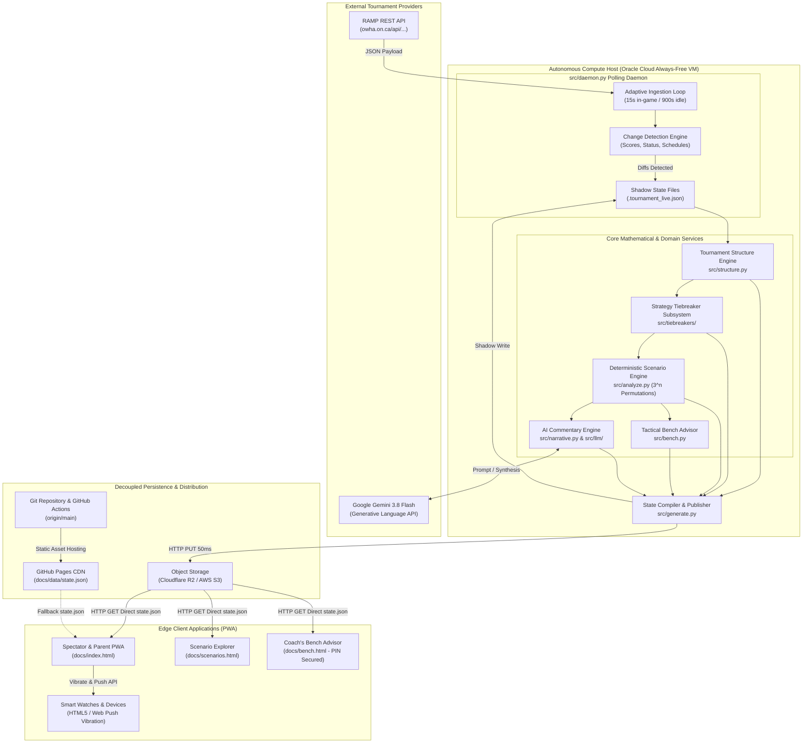
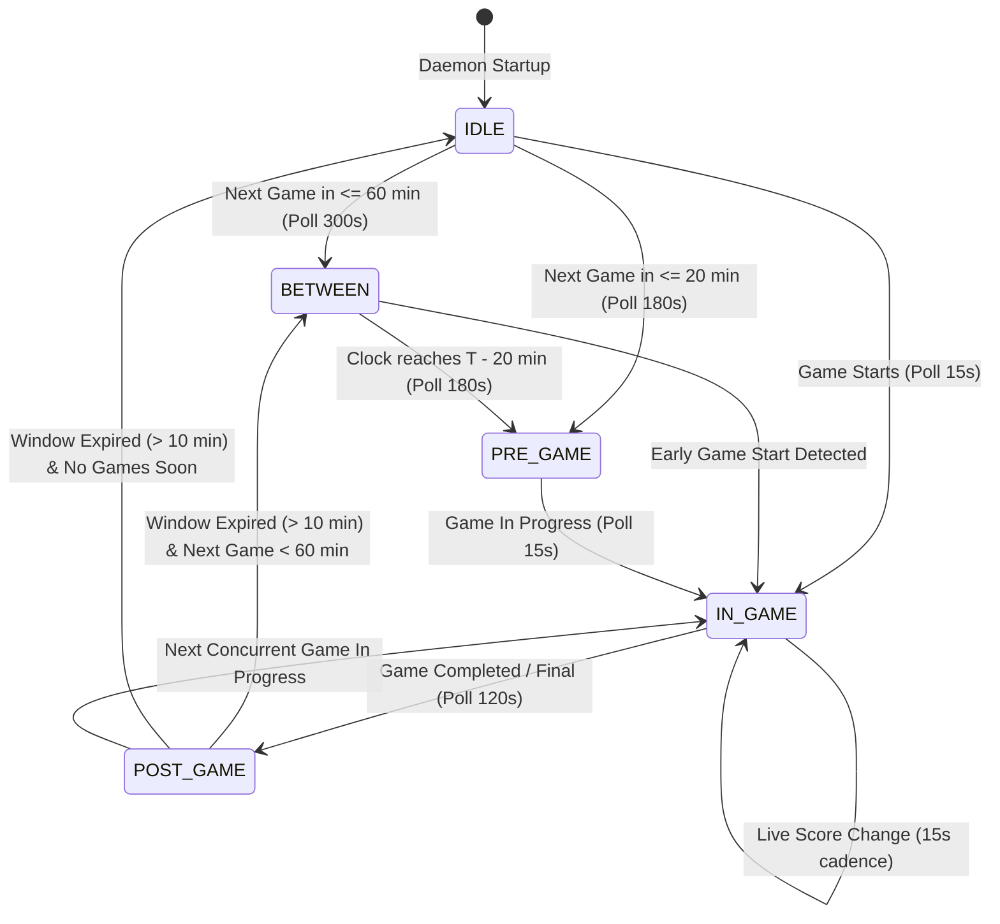
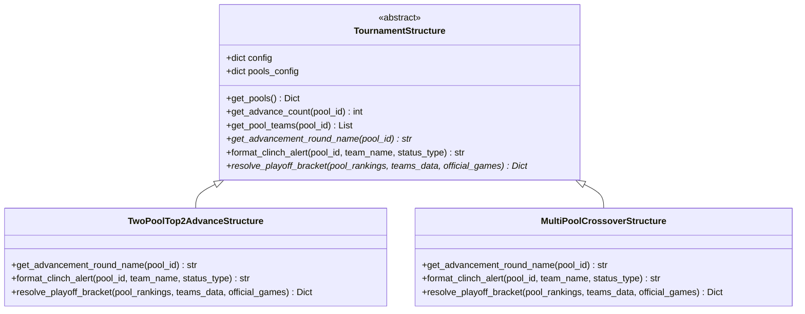
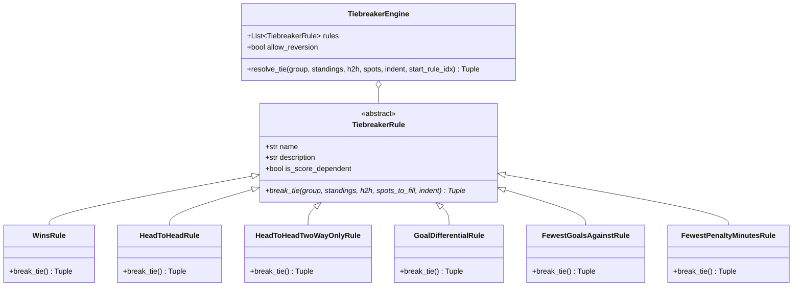
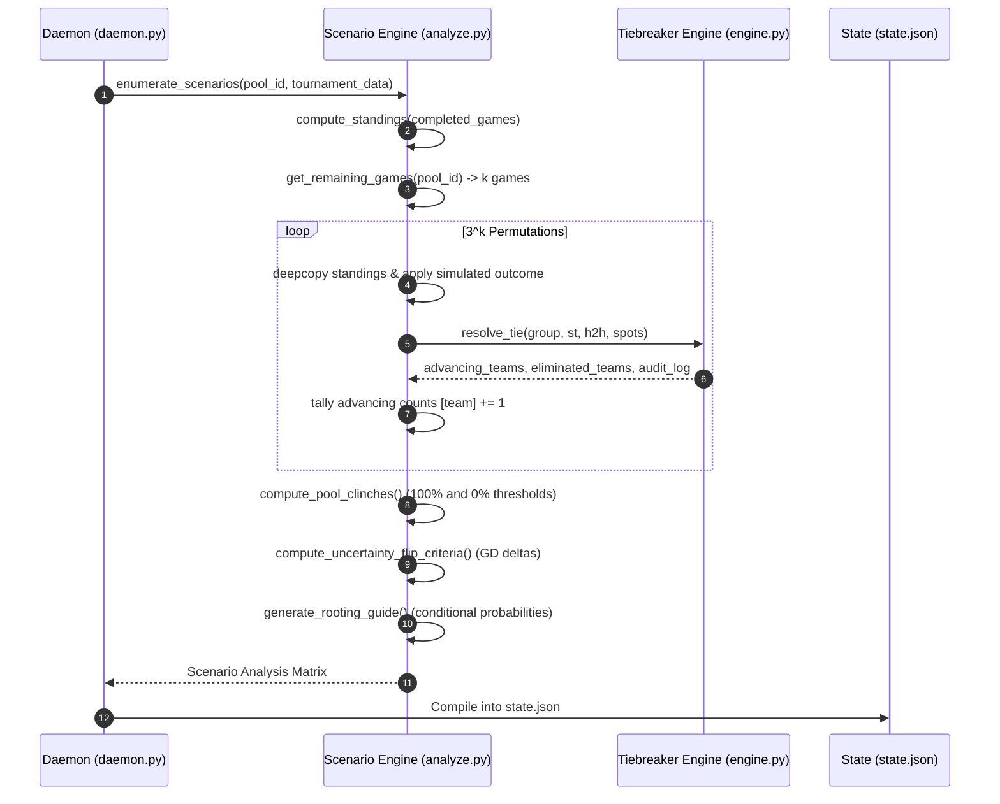
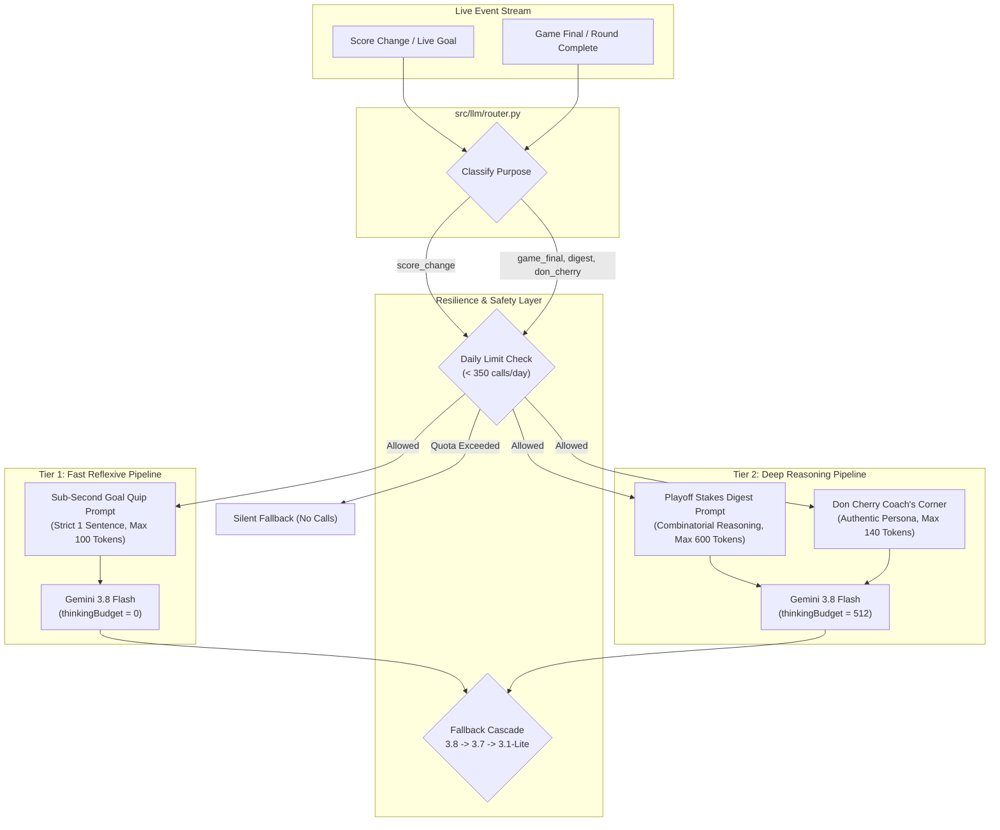

# Rinkside Tournament Platform — System Architecture & Technical Design

> **Production-Grade Technical Architecture Specification**  
> **System:** Rinkside Real-Time Minor Hockey Tournament Companion & Mathematical Clinch Engine  
> **Target Deployments:** OWHA Provincial Championships & Regional Invitational Tournaments (e.g., Pink the Rink XV)  
> **Author:** Antigravity AI Engineering Architecture Team  
> **Document Version:** 2.6.0 (Production Release)  
> **Status:** Active / Production  

---

## Table of Contents
1. [Executive Architecture Overview (Hybrid Cloud)](#1-executive-architecture-overview-hybrid-cloud)
2. [Data Ingestion & RAMP API Engine](#2-data-ingestion--ramp-api-engine)
3. [Tournament Domain Model & Polymorphic Structure Engine](#3-tournament-domain-model--polymorphic-structure-engine)
4. [Pluggable Strategy-Pattern Tiebreaker Subsystem](#4-pluggable-strategy-pattern-tiebreaker-subsystem)
5. [Deterministic Scenario Permutation & Clinch Proof Engine](#5-deterministic-scenario-permutation--clinch-proof-engine)
6. [Tactical Bench Advisor & Goalie-Pull Calculus](#6-tactical-bench-advisor--goalie-pull-calculus)
7. [Hierarchical AI Commentary Engine](#7-hierarchical-ai-commentary-engine)
8. [Mobile-First PWA & Live Rink UX](#8-mobile-first-pwa--live-rink-ux)
9. [Deployment & DevOps Lifecycle](#9-deployment--devops-lifecycle)
10. [System Verification & Testing Matrix](#10-system-verification--testing-matrix)

---

## 1. Executive Architecture Overview (Hybrid Cloud)

### 1.1 Core Architectural Philosophy
The Rinkside platform is designed around a fundamental principle: **"Heavy Autonomous Edge Compute, Zero-Maintenance High-Availability Client Delivery."**

Minor hockey tournaments (sanctioned by bodies such as the Ontario Women's Hockey Association - OWHA) create severe architectural demands:
- **Zero-Latency Spikes:** Sudden surges in traffic when games end and hundreds of parents, coaches, and scouts refresh standings simultaneously.
- **Rink Network Hostility:** Cold arena environments with spotty cellular data coverage, requiring lightweight, highly resilient client bundles.
- **Strict Budget Constraints:** Zero dedicated server operational budget, necessitating free-tier infrastructure that runs indefinitely without maintenance.
- **Mathematical Exactness:** Tiebreakers and elimination scenarios cannot be approximate; they must match governing rulebooks down to the goal differential, penalty minute, or coin toss.

To meet these requirements, Rinkside implements a **Hybrid Cloud Architecture**:
1. **Autonomous Compute Daemon (OCI Always-Free VM):** An unattended Python daemon running on an Oracle Cloud Infrastructure (OCI) ARM/x86 Always-Free Compute instance (`ubuntu@132.145.100.44`). The daemon handles all data ingestion, network retry loops, 3^n scenario calculations, tiebreaker recursion, LLM synthesis, and state compilation.
2. **High-Availability Edge PWA (GitHub Pages CDN + Edge Cache):** The compiled tournament state is serialized into a single immutable, versioned JSON payload (`state.json`) and published to GitHub Pages. Delivery is powered by global CDN edge caching (Fastly/Edge), providing 100% serverless uptime, microsecond response times, and infinite read scalability with zero cloud egress costs.
3. **Decoupled Dual-Write Object Storage (Optional S3/R2 Backend):** Through [`src/storage.py`](file:///home/dpauls/rangers-u15b-provincials-2026/src/storage.py), the engine optionally dual-writes state updates to Amazon S3 or Cloudflare R2 object storage with `no-cache, must-revalidate` cache control headers for instant headless updates bypassing git push propagation latencies.

### 1.2 System Topology & Data Flow Diagram



### 1.3 Architecture Characteristics Matrix

| Dimension | Architectural Implementation | Operational Characteristic |
| :--- | :--- | :--- |
| **Compute Tier** | Python 3.12 Daemon in Docker on OCI VM | Self-healing (`restart: unless-stopped`), autonomous, persistent |
| **Storage Tier** | File-backed Shadow State + Git Versioning | Crash-resilient, git-pull safe, auditable history of every score change |
| **Edge Distribution**| Static CDN (GitHub Pages / Fastly Edge) | 0 ms cold starts, 99.999% availability, zero infrastructure maintenance |
| **Compute Scalability**| O(1) Client Serving Cost | Compute workload is decoupled from traffic volume; 1 or 10,000 users cost $0 |
| **In-Game Polling** | 15-second active loop | Real-time score awareness within 15 seconds of official scorekeeper entry |
| **Combinatorics** | Exhaustive Cartesian product ($3^k$) | Deterministic mathematical proofs; 0% hallucination or probability guessing |
| **AI Inference** | Google Gemini 3.8 Flash (`thinkingBudget: 0 vs 512`) | Dual-speed: Sub-second live goal quips vs deep playoff stakes analysis |
| **Security Air-Gap** | Read-Only Client State + Client-Side PIN | Opponents cannot tamper with state; bench tactical notes are locked |

---

## 2. Data Ingestion & RAMP API Engine

### 2.1 The RAMP REST Platform
The Ontario Women's Hockey Association uses the RAMP Interactive tournament management suite. Rather than fragile HTML web scraping, [`src/scraper.py`](file:///home/dpauls/rangers-u15b-provincials-2026/src/scraper.py) communicates directly with RAMP's internal RESTful JSON endpoints utilized by their front-end web portal.

#### Primary Ingestion Endpoints
```http
# 1. Division Schedule & Live Game Scores
GET https://www.owha.on.ca/api/leaguegame/get/{league_id}/{season_id}/0/{division_id}/{game_type}/0/0

# 2. Pool-Structured Division Standings (Cached Server-Side)
GET https://www.owha.on.ca/api/leaguegame/getstandings3wsdcached/{league_id}/{season_id}/0/0/{division_id}/0

# 3. Playoff & Bracket Games (Finals / Bronze)
GET https://www.owha.on.ca/api/leaguegame/get/{league_id}/{season_id}/0/{division_id}/5384/0/0  (Finals)
GET https://www.owha.on.ca/api/leaguegame/get/{league_id}/{season_id}/0/{division_id}/5428/0/0  (Bronze)
```

### 2.2 Network Hardening & Anti-Blocking Measures
Tournament networks and RAMP servers frequently exhibit transient routing drops, SSL expiration on regional municipal municipal subdomains, and sudden rate-limiting spikes. `src/scraper.py` implements a robust network defense stack:

1. **Browser Fingerprint Emulation:** All requests carry modern browser user agents (`Chrome/124.0.0.0 Safari/537.36`) and standard `Accept: application/json, text/plain, */*` headers, bypassing naive bot blockers.
2. **Municipal SSL Bypass:** Municipal arenas often run custom reverse proxies with expired root certificates. An unverified default SSL context (`ssl.CERT_NONE`) guarantees connectivity is never severed by municipality SSL misconfigurations.
3. **Exponential Backoff with Full Jitter:**
   $$\text{Delay}_i = \text{RETRY\_DELAYS}[i] + \text{Uniform}(0.1, 0.4)$$
   Retries transient HTTP errors (`429`, `500`, `502`, `503`, `504`), socket timeouts (12s threshold), and connection resets across 5 attempts (`[0.5s, 1.0s, 1.5s, 2.0s, 3.0s]`).
4. **Transient 404 Resilience:** RAMP's internal load balancers occasionally return transient `404 Not Found` responses when syncing new divisions. The scraper performs targeted short-delay retries on 404s before concluding an endpoint is genuinely absent.

### 2.3 Adaptive Polling Loop State Machine
The daemon ([`src/daemon.py`](file:///home/dpauls/rangers-u15b-provincials-2026/src/daemon.py)) optimizes API call efficiency using an adaptive polling state machine:



#### Polling Cadence Definitions
- **`POLL_INGAME` (15 seconds):** Active when any game in the division has `status == 'in_progress'` or `liveScores == True`. Ensures rinkside score changes appear almost immediately on parents' phones.
- **`POLL_POSTGAME` (120 seconds):** Active for 10 minutes immediately after a game goes final to capture post-game score corrections, official stat sheet sign-offs, and penalty minute uploads.
- **`POLL_PREGAME` (180 seconds):** Active within 20 minutes of scheduled game start to detect early puck-drops.
- **`POLL_BETWEEN` (300 seconds):** Active during intermission breaks between games (within 60 minutes).
- **`POLL_IDLE` (900 seconds / 15 minutes):** Overnight or morning hibernation when no games are scheduled for hours.

### 2.4 Shadow File State Integrity
A major vulnerability in continuous-deployment daemons is local state corruption caused by git operations (e.g., `git pull`, `git checkout`). If an operator pulls updates to code while a live game is being tracked, an uncommitted `state.json` or `tournament.json` would be overwritten or cause git merge conflicts.

Rinkside resolves this with **Shadow File Architecture**:
```
Live State (Gitignored, Single Source of Truth):
  ├── data/.tournament_live.json
  └── docs/data/.state_live.json

Tracked Distribution Artifacts (Committed & Published):
  ├── data/tournament.json
  └── docs/data/state.json
```
- The daemon reads and writes exclusively to the hidden shadow files during all polling and simulation cycles.
- When and only when a push to GitHub is warranted, `_publish_to_git()` copies shadow files over the tracked files via atomic filesystem operations (`shutil.copy2`) before executing `git commit` and `git push`.
- Operators can run `git pull origin main` on the host VM at any time without terminating the daemon or corrupting live in-game data.

---

## 3. Tournament Domain Model & Polymorphic Structure Engine

### 3.1 Domain Model Design
The tournament architecture abstracts tournament rules, divisional setups, and advancement criteria into a modular structure managed by [`src/structure.py`](file:///home/dpauls/rangers-u15b-provincials-2026/src/structure.py).



### 3.2 Supported Tournament Formats
The polymorphic structure engine supports arbitrary multi-pool configurations:

#### 1. Two-Pool Top-2 Advance (`TwoPoolTop2AdvanceStructure`)
- **Use Case:** Regional Invitational Tournaments (e.g., Pink the Rink XV U18C).
- **Format:** 2 pools (Pool A, Pool B) of 4 teams each (8 teams total).
- **Advancement:** Top 2 teams from each pool advance to Semifinals; 3rd and 4th place teams advance to Consolation brackets.
- **Matchup Mapping:**
  - **Semi 1:** 1st in Pool A vs. 2nd in Pool B
  - **Semi 2:** 1st in Pool B vs. 2nd in Pool A
  - **Consolation 1:** 3rd in Pool A vs. 3rd in Pool B
  - **Consolation 2:** 4th in Pool A vs. 4th in Pool B
  - **Championship Final:** Winner Semi 1 vs. Winner Semi 2

#### 2. Multi-Pool Crossover (`MultiPoolCrossoverStructure`)
- **Use Case:** OWHA Provincial Championships (e.g., U15B Provincials).
- **Format:** 4 to 8 pools of 3–5 teams each (e.g., 8 pools of 4 = 32 teams).
- **Advancement:** Exactly 1 team (the pool winner) advances to the Quarterfinals.
- **Crossover Pairing:** Configured dynamically via JSON (e.g., Winner Pool A vs. Winner Pool H, Winner Pool B vs. Winner Pool G, etc.).

### 3.3 Dynamic Playoff Bracket Resolution
The bracket resolution engine operates in four discrete state phases per matchup slot:
- `tbd`: Neither team has clinched; displayed with placeholder labels (e.g., `"1st in Pool A"`).
- `partial`: One team has clinched their seeding, awaiting their opponent.
- `clinched`: Both seeds are mathematically locked prior to pool play completion.
- `final`: All pool games are final and seeds are official.

---

## 4. Pluggable Strategy-Pattern Tiebreaker Subsystem

### 4.1 Subsystem Design (`src/tiebreakers/`)
Tournament tiebreakers are notoriously fraught with misinterpretation, conflicting interpretations between head-to-head and goal differential, and operator confusion. Rinkside implements a pluggable **GoF Strategy Pattern** in [`src/tiebreakers/`](file:///home/dpauls/rangers-u15b-provincials-2026/src/tiebreakers/):



### 4.2 Rules Registry & Concrete Implementations

| Rule Key | Class | Rulebook Logic | Score Dep? |
| :--- | :--- | :--- | :---: |
| `wins` | `WinsRule` | Most total wins in round-robin play. | No |
| `head_to_head` | `HeadToHeadRule` | Standard OWHA rule: Points in games between all tied teams (mini-table). | No |
| `head_to_head_two_way_only` | `HeadToHeadTwoWayOnlyRule` | **Pink the Rink Rule 16b:** H2H applies **if and only if exactly 2 teams are tied**. If >2 teams tied, rule is explicitly skipped. | No |
| `goal_diff` | `GoalDifferentialRule` | Goal differential: $\text{GF} - \text{GA}$ across all round-robin games. | **Yes** |
| `fewest_goals_against` | `FewestGoalsAgainstRule`| Fewest total goals allowed ($\text{GA}$) across round-robin games. | **Yes** |
| `fewest_pim` | `FewestPenaltyMinutesRule` | Fewest total penalty minutes ($\text{PIM}$). | No |

### 4.3 Deep Dive: Pink the Rink Rule 16 vs. Standard OWHA

#### 1. Two-Way vs. Multi-Team Head-to-Head
In standard OWHA championship rules, when 3 teams are tied, a mini-table of games played between those 3 teams is calculated. In contrast, **Pink the Rink Rule 16b** explicitly commands:
> *"Head-to-head record (this applies only if two teams are tied; if more than two teams are tied, this criterion does not apply and the tiebreaker moves immediately to goal differential)."*

If Team A, Team B, and Team C are tied with circular wins (A beat B, B beat C, C beat A), `HeadToHeadTwoWayOnlyRule` detects `len(group) > 2`, emits an audit trace:
`"Rule (h2h 2-way only): 3 teams tied — criterion does NOT apply (skipped)"`, and passes the entire group directly to Goal Differential without discarding H2H prematurely for future 2-way ties.

#### 2. Raw Goal Differential vs. Goal Percentage
- **Standard OWHA Provincials Formula:** 
  $$\text{Ratio} = \frac{\text{GF}}{\text{GF} + \text{GA}}$$
- **Pink the Rink Rule 16c Formula:**
  $$\text{GD} = \text{GF} - \text{GA}$$
Rinkside implements raw $\text{GF} - \text{GA}$ as defined by the tournament's specific sanctions, preventing erroneous seedings that occur when using ratio calculations on minor hockey scores.

#### 3. Non-Reverting Rule Chains (`allow_reversion = False`)
A critical edge case in tournament tiebreakers: If 3 teams are tied for 2 spots, and Rule 3 (Goal Differential) identifies the 1st place team (advancing them), how are the remaining 2 teams evaluated for the final spot?
- Under **Reverting rules** (`allow_reversion = True`), the engine starts over at Rule 1 (Wins / H2H) for the remaining 2 teams.
- Under **Non-Reverting rules** (`allow_reversion = False` - mandated by Pink the Rink Rule 16), the remaining teams **continue forward** to Rule 4 (Fewest Goals Against). They never revert to earlier rules.

```python
# From src/tiebreakers/engine.py (lines 69-73)
next_idx = 0 if self.allow_reversion else r_idx + 1
sub_a, sub_e, sub_lines, sub_score_dep, sub_unres = self.resolve_tie(
    subg, standings, h2h, rem_spots, indent + '    ', next_idx
)
```

### 4.4 Automated Source Citation & Verification
Every tournament configuration JSON (`data/tournaments/*.json`) mandates a `tiebreakers` object containing full administrative citations:
```json
"tiebreakers": {
  "source_name": "Pink the Rink XV Tournament Rules (Rule 16)",
  "source_url": "https://etobicokedolphins.ca/Public/Documents/Pink_the_Rink_XV_Tournament_RULES_2026.pdf",
  "rules": [
    "wins",
    "head_to_head_two_way_only",
    "goal_diff",
    "fewest_goals_against",
    "fewest_pim"
  ],
  "allow_reversion": false
}
```
This metadata is exposed directly in the UI footer and tiebreaker modals, providing coaches and parents with instant, authoritative rule citations during disputed rinkside decisions.

---

## 5. Deterministic Scenario Permutation & Clinch Proof Engine

### 5.1 Combinatorial Explosion Calculus ($3^n$)
In a 4-team pool with 6 total games, each game can end in one of 3 discrete outcomes:
$$\Omega = \{\text{Home Win}, \text{Tie}, \text{Away Win}\}$$
For $k$ remaining games, the total possible scenario space $\mathcal{S}$ is:
$$|\mathcal{S}| = 3^k$$

| Remaining Games ($k$) | Scenario Space ($3^k$) | Compute Time (Python 3.12) |
| :---: | :---: | :---: |
| 6 (Tournament Start) | 729 | 18 ms |
| 5 | 243 | 6 ms |
| 4 | 81 | 2 ms |
| 3 | 27 | < 1 ms |
| 2 | 9 | < 0.5 ms |
| 1 | 3 | < 0.1 ms |

Because $k \le 6$ across all round-robin pools, Rinkside does **not** rely on stochastic Monte Carlo sampling or approximate probabilities. It enumerates the complete Cartesian product $\prod_{i=1}^k \{0, 1, 2\}$ deterministically on every polling cycle using `itertools.product`.



### 5.2 Mathematical Clinch Proofs
A team's playoff qualification status is mathematically proven across all possible future worlds $\mathcal{S}$:
- **Clinched 1st Place:**
  $$\text{ClinchedFirst}(T) \iff \forall s \in \mathcal{S}, \quad \text{Rank}(T, s) = 1$$
- **Clinched Playoff Berth:**
  $$\text{ClinchedPlayoff}(T) \iff \forall s \in \mathcal{S}, \quad \text{Rank}(T, s) \le \text{AdvanceCount}$$
- **Mathematically Eliminated:**
  $$\text{Eliminated}(T) \iff \forall s \in \mathcal{S}, \quad \text{Rank}(T, s) > \text{AdvanceCount}$$

If a team finishes in an advancing spot in 80 out of 81 scenarios, Rinkside reports their advancement odds as **98.8%**, but strictly **refuses** to emit a clinch badge until the count reaches $81 / 81$ (100.0%).

### 5.3 Goal Differential Margin Flip Thresholds
When tiebreakers reach score-dependent rules (`GoalDifferentialRule` or `FewestGoalsAgainstRule`), simulated games apply a baseline 1-goal victory margin. However, actual games can end with larger margins.

To prevent parents from being blindsided by score differentials, [`compute_uncertainty_flip_criteria()`](file:///home/dpauls/rangers-u15b-provincials-2026/src/analyze.py#L262) computes the exact **Goal Differential Margin Flip Threshold**:
$$\Delta_{\text{required}} = (GD_{\text{advancing}} - GD_{\text{eliminated}}) + 1$$

The engine formulates dynamic, human-readable threshold statements embedded in the UI:
- *"Kanata holds spot unless Belmont victory margin exceeds Kanata victory margin by $\ge 3$ goals."*
- *"East Ottawa advances if victory margin exceeds Woodstock margin by $\ge 1$ goal."*

### 5.4 Concurrent Game Rooting Guide
Spectating parents often wonder who to cheer for in games taking place on adjacent rink pads. [`generate_rooting_guide()`](file:///home/dpauls/rangers-u15b-provincials-2026/src/analyze.py#L330) evaluates all concurrent external games ($g \notin \text{our\_games}$) and computes the conditional probability of our team advancing under each outcome:

$$\text{Swing} = \max\left(P(\text{adv} \mid H_{\text{win}}), P(\text{adv} \mid \text{Tie}), P(\text{adv} \mid A_{\text{win}})\right) - \min\left(P(\text{adv} \mid H_{\text{win}}), P(\text{adv} \mid \text{Tie}), P(\text{adv} \mid A_{\text{win}})\right)$$

The guide outputs actionable spectator recommendations:
> **Root for Wilmot Wolverine:** Gives Kanata **100.0%** advancement odds vs. **44.4%** if Belmont Blazers win (Swing: **55.6%**).

---

## 6. Tactical Bench Advisor & Goalie-Pull Calculus

### 6.1 Rationale & Problem Formulation
In the final 3 minutes of the 3rd period, a minor hockey coach trailing by 1 goal faces a high-stakes tactical dilemma: **Should they pull their goaltender for a 6-on-5 extra attacker?**

In league play, pulling the goalie is an easy decision (a loss is a loss). In tournament play governed by Goal Differential tiebreakers, **pulling the goalie can be fatal**. Conceding an empty-net goal changes a $-1$ loss into a $-2$ loss. If the team is later tied in points with another team, that 1 extra goal against can eliminate them from playoff contention.

[`src/bench.py`](file:///home/dpauls/rangers-u15b-provincials-2026/src/bench.py) implements the **Goalie-Pull Decision Calculus** to give coaches instant, objective guidance on the bench.

```mermaid
flowchart TD
    Start["Coach Checks Bench Advisor (/bench.html)"] --> ScoreCheck{"Current Score Margin?"}

    ScoreCheck -->|Leading by >= 1| GreenLead["GREEN: Protect Lead<br/>Maintain defensive structure. Do NOT pull."]
    ScoreCheck -->|Tied (Diff == 0)| TieCheck{"Does a Tie Guarantee Berth?"}
    ScoreCheck -->|Trailing by 1 (Diff == -1)| DownsideCheck{"Empty-Net Downside Risk?"}
    ScoreCheck -->|Trailing by >= 3| RedCeiling["RED: Deficit Ceiling<br/>Protect GD. Pulling risks blowout."]

    TieCheck -->|Advancement on Tie == 100%| GreenTie["GREEN: Hold the Tie<br/>Tie guarantees advancement. Zero risk."]
    TieCheck -->|Advancement on Tie == 0%| RedMustWin["RED: Must Win Regulation<br/>Tie eliminates us. PULL GOALIE LATE."]
    TieCheck -->|0% < Adv < 100%| YellowTie["YELLOW: Tough Call<br/>Evaluate concurrent game score."]

    DownsideCheck -->|P(Loss-2) == P(Loss-1)| RedPull["RED: Pull Goalie Late (Zero Downside)<br/>Losing by 2 has identical odds to losing by 1.<br/>Zero penalty for pulling goalie!"]
    DownsideCheck -->|P(Loss-2) < P(Loss-1)| YellowCaution["YELLOW: High Downside Risk<br/>Empty net goal drops advancement odds from 40% to 0%.<br/>Protect GD unless tie is mandatory!"]
```

### 6.2 Goal Margin Payoff Matrix ($-3$ to $+3$)
[`compute_margin_payoff_matrix()`](file:///home/dpauls/rangers-u15b-provincials-2026/src/bench.py#L14) simulates all 7 possible score differentials around the current game, taking into account live scores in concurrent games:

```json
[
  {"margin": -3, "label": "Lose by 3 (-3)", "sim_score": "1-4", "adv_pct": 0.0, "status": "ELIMINATED"},
  {"margin": -2, "label": "Lose by 2 (-2)", "sim_score": "1-3", "adv_pct": 0.0, "status": "ELIMINATED"},
  {"margin": -1, "label": "Lose by 1 (-1)", "sim_score": "1-2", "adv_pct": 0.0, "status": "ELIMINATED"},
  {"margin":  0, "label": "Tie (0)",        "sim_score": "2-2", "adv_pct": 50.0, "status": "POSSIBLE"},
  {"margin": +1, "label": "Win by 1 (+1)",  "sim_score": "3-2", "adv_pct": 100.0, "status": "CLINCH"},
  {"margin": +2, "label": "Win by 2 (+2)",  "sim_score": "4-2", "adv_pct": 100.0, "status": "CLINCH"},
  {"margin": +3, "label": "Win by 3 (+3)",  "sim_score": "5-2", "adv_pct": 100.0, "status": "CLINCH"}
]
```

### 6.3 Empty-Net Downside Risk Analysis
The advisor formalizes empty-net risk by comparing advancement probabilities between a 1-goal deficit and a 2-goal deficit:
$$\text{HasDownside} \iff P(\text{advance} \mid \text{margin} = -1) > 0 \quad \land \quad P(\text{advance} \mid \text{margin} = -2) < P(\text{advance} \mid \text{margin} = -1)$$

1. **Zero Downside Case:**
   If $P(\text{advance} \mid \text{margin} = -1) = 0\%$, the team is already eliminated on a 1-goal loss. Conceding an empty-net goal costs nothing:
   > *"ZERO DOWNSIDE: Losing by 2 has the same advancement odds as losing by 1 (0.0%). No GD penalty for pulling the goalie. Need the tie!"*
2. **High Downside Case:**
   If $P(\text{advance} \mid \text{margin} = -1) = 44.4\%$ (via goal differential tiebreaker) but $P(\text{advance} \mid \text{margin} = -2) = 0.0\%$:
   > *"HIGH DOWNSIDE: Conceding an empty-net goal (-2 margin) drops advancement odds from 44.4% to 0.0%. Protect GD unless tie is mandatory."*

### 6.4 Dynamic Salted SHA-256 PIN Security & Invalidation
Tactical bench advice must not fall into the hands of opposing teams or casual spectators. However, hardcoding PINs in client-side code or storing raw boolean flags (`is_authenticated = true`) creates significant security flaws:
1. Anyone inspecting `state.json` or source code could read the PIN.
2. If a PIN leaked and was changed on the server, previously authenticated browsers remained permanently unlocked.

To eliminate both vulnerabilities, Rinkside implements an **Environment-Driven, Salted SHA-256 Hash Architecture with Dynamic Client Invalidation**:


1. **Server-Side Hash Computation (`src/generate.py`):**
   Pins are configured per deployment in `.env` (`COACH_PIN=1777`, `ADMIN_PIN=9876`). The generator reads the active tournament salt (e.g., `salt = "ptr_2026_u18c"`) and computes:
   $$\text{coach\_pin\_hash} = \text{SHA-256}(\text{salt} + \text{":"} + \text{COACH\_PIN})$$
   $$\text{admin\_pin\_hash} = \text{SHA-256}(\text{salt} + \text{":"} + \text{ADMIN\_PIN})$$
   Only the salt and hex digests are published in `state.json`. Plaintext PINs are **never** committed or exposed over the wire.
2. **Client-Side Comparison (`bench.html` & `admin.html`):**
   The browser uses the native Web Crypto API (`crypto.subtle.digest('SHA-256', ...)`) to hash the user's input.
3. **Dynamic Invalidation:**
   The browser persists **only the entered PIN string** (scoped to tournament and team ID), never a raw authenticated boolean. On every 15-second data refresh, the browser re-hashes the stored PIN against the latest hash from OCI Object Storage. If you update `.env` on the VM, every client is immediately kicked out on their next poll.

### 6.5 Live Stream Broadcast Management (`docs/admin.html`)
To allow team staff or volunteers to attach YouTube livestream URLs directly from the arena concourse without requiring terminal or SSH access:
1. **Admin Console (`docs/admin.html`):** Protected by `ADMIN_PIN`. Displays all division games with live/scheduled badges and a stream URL input box.
2. **Pre-Authenticated Request (PAR) Ingestion:** When an admin saves a stream URL, the browser issues an HTTPS `PUT` of the updated streams dictionary to an OCI Pre-Authenticated Request URL (`STREAMS_PAR_URL`).
3. **Autonomous Synchronization:** The background daemon on the VM monitors the object storage `streams.json`. When a change is detected, it immediately updates `state.json` and pushes to OCI Object Storage, displaying the red `▶ Stream` badge across all spectator PWAs within seconds.
4. **CLI Alternative:** Terminal access via `python3 src/stream.py <game_id> <url>` remains fully functional as a local or SSH fallback.

---

## 7. Hierarchical AI Commentary Engine

### 7.1 Tiered Reasoning Architecture
Minor hockey audiences require two distinct forms of AI reporting:
1. **Sub-Second Live Reaction:** High-frequency, energetic goal quips when an event occurs rinkside.
2. **Deep Analytical Synthesis:** Comprehensive playoff stakes digests when games conclude.

Rinkside implements a **Hierarchical AI Commentary Pipeline** powered by Google Gemini 3.8 Flash via [`src/llm/`](file:///home/dpauls/rangers-u15b-provincials-2026/src/llm/) and [`src/narrative.py`](file:///home/dpauls/rangers-u15b-provincials-2026/src/narrative.py):



### 7.2 Gemini 3.8 Flash Thinking Budget Controls
Gemini 3.8 Flash allows explicit allocation of reasoning tokens via `thinkingConfig.thinkingBudget`:
- **Low Thinking (`thinkingBudget = 0`):** Used for live score changes and goal events (`generate_event_impact`). Turns around responses in under 700 ms to push immediate mobile notifications to parents.
- **High Thinking (`thinkingBudget = 512`):** Used for `tournament_digest`, `game_final`, `bench_advice`, and `don_cherry`. The model reasons deeply through the 3^n scenario matrix and tiebreaker rules before generating output, eliminating factual hallucinations.

### 7.3 Model Fallback Cascade & Quota Resilience
To ensure zero service interruptions during tournament weekends, [`GeminiProvider`](file:///home/dpauls/rangers-u15b-provincials-2026/src/llm/gemini.py) implements an automatic model fallback cascade:
```python
# Primary model with automatic degraded fallback sequence
models_to_try = [
    "gemini-3.8-flash",
    "gemini-3.7-flash", 
    "gemini-3-flash-preview", 
    "gemini-3.1-flash-lite"
]
```
- **HTTP 429 Quota Exhaustion:** If a daily free-tier limit is encountered (`RESOURCE_EXHAUSTED`), the provider immediately cascades to the next model in the list without wasting retries.
- **HTTP 503 Capacity Spikes:** Implements exponential backoff with a 1.5-second pause.

### 7.4 Daily API Spend Safety Circuit Breaker
To prevent runaway billing or infinite polling loops from exhausting developer credit cards, `GeminiProvider` enforces an in-memory hardware safety circuit breaker:
```python
MAX_DAILY_CALLS = int(os.environ.get("GEMINI_MAX_DAILY_CALLS", "350"))
```
When `_daily_calls >= 350`, the provider halts all external requests and emits a warning log:
`"GeminiProvider safety limit reached: 350 calls today. Halting API calls to protect budget."`
The counter automatically resets at midnight based on system date.

### 7.5 Authentic Coach's Corner Don Cherry Persona
The system features an AI implementation of Hockey Night in Canada legend **Don Cherry** ([`generate_don_cherry`](file:///home/dpauls/rangers-u15b-provincials-2026/src/narrative.py#L473)) tailored for minor girls' hockey:
- **Tone:** Enthusiastic, grandfatherly, proud, desk-slapping energy.
- **Values:** Backchecking, shot-blocking, team passing, protecting the goaltender, and sportsmanship.
- **Stylistic Constraints:**
  - Iconic openings: *"Now listen...", "I tell ya right now...", "Boy oh boy oh boy..."*
  - Telegraphic, punchy clauses with vocal acoustic punches in capital letters (*"THAT is how you play hockey!", "BOOM", "HOLY JUMPIN'"*).
  - Strict length constraint: Exactly 2 to 3 punchy sentences (maximum 75 words) to fit mobile cards.
  - Strict safety rule: 100% positive and encouraging to young players; zero sarcasm or negativity.

---

## 8. Mobile-First PWA & Live Rink UX

### 8.1 Arena Environment Design Constraints
Ice rinks represent a hostile computing environment:
- Temperatures hovering near 0°C (32°F), causing touchscreen sluggishness and cold fingers.
- Poor indoor LTE/5G cellular signals through corrugated steel arena roofs.
- Harsh glare from arena stadium lighting or dim spectator seating.

### 8.2 Progressive Web App Architecture
Rinkside is packaged as a standalone Progressive Web App compliant with modern W3C PWA standards:
- **Web App Manifest (`docs/manifest.json`):** Defines `display: standalone`, `orientation: portrait-primary`, and brand icons (`icon-192.png`, `icon-512.png`, `apple-touch-icon.png`).
- **Service Worker (`docs/sw.js`):** Intercepts push notifications and provides offline client caching with instant client claim.

### 8.3 Screen Wake Lock ("Rink Mode")
Smartphones routinely time out and lock screens after 30 seconds to conserve battery. In an arena, having to unlock a phone with cold fingers every time a whistle blows is frustrating.

Rinkside implements the W3C Screen Wake Lock API (`toggleWakeLock()` in [`docs/index.html`](file:///home/dpauls/rangers-u15b-provincials-2026/docs/index.html#L775)):
```javascript
let wakeLock = null;
async function toggleWakeLock() {
    if (!('wakeLock' in navigator)) return;
    try {
        if (!wakeLock) {
            wakeLock = await navigator.wakeLock.request('screen');
            updateWakeBtn(true);
        } else {
            await wakeLock.release();
            wakeLock = null;
            updateWakeBtn(false);
        }
    } catch (err) {
        console.warn('WakeLock error:', err);
    }
}
```
Activating **"⚡ Keep Awake (Rink Mode)"** holds the display active continuously throughout the game.

### 8.4 Smart Watch Alerts & Haptic Vibrations
When a goal is scored or a game goes final, the platform emits multi-channel sensory alerts:
1. **HTML5 Web Notifications:** Delivered via standard notification APIs with association branding logos.
2. **Distinctive Hockey Haptic Rhythm:** Emits a custom 5-pulse vibration cadence on smart watches (Apple Watch, WearOS) and Android devices:
   ```javascript
   navigator.vibrate([200, 100, 200, 100, 200]); // Two rapid double-taps
   ```
3. **Granular Game Subscriptions:** Parents can subscribe to specific games using the "🔔 Alert me" button, silencing alerts from irrelevant pool games.

### 8.5 Fluid Multi-Pool Chip Navigation
For multi-pool tournaments (e.g., 8 pools in Provincials), traditional dropdown menus require awkward two-handed interaction. Rinkside implements horizontal scrolling pill navigation (`.pool-pills`):
- Touch-friendly, zero-friction chip toggles.
- Real-time client-side pool switching with microsecond DOM updates.
- Highlights "OUR POOL" with distinctive association color badges.

---

## 9. Deployment & DevOps Lifecycle

### 9.1 Containerization (Docker & Docker Compose)
The daemon is fully containerized via [`Dockerfile`](file:///home/dpauls/rangers-u15b-provincials-2026/Dockerfile) based on `python:3.12-slim`:
```dockerfile
FROM python:3.12-slim
WORKDIR /app
RUN apt-get update && apt-get install -y --no-install-recommends git && rm -rf /var/lib/apt/lists/*
COPY requirements.txt .
RUN pip install --no-cache-dir -r requirements.txt
COPY src/ src/
COPY data/ data/
COPY docs/ docs/
COPY scripts/ scripts/
COPY test/ test/
ENV PYTHONUNBUFFERED=1
RUN git config --global --add safe.directory /app
ENTRYPOINT ["python3", "src/daemon.py"]
```

#### Service Profiles in `docker-compose.yml`
- **`tracker`:** Production live service. Mounts `.git`, `data/`, `docs/`, and `logs/` volumes with restart protection.
- **`mock-test` (Profile: `test`):** Advances through synthetic tournament steps without pushing to GitHub.
- **`mock-reset` (Profile: `test`):** Clears scores and event logs, returning tournament state to step 0.
- **`mock-jump` (Profile: `test`):** Fast-forwards directly to a specific mock tournament step (e.g., `docker compose run mock-jump 11`).

### 9.2 Automated Deployment Pipeline (`scripts/deploy.sh`)
Deployments from a developer machine to the Oracle Cloud VM are executed via a single automated shell script ([`scripts/deploy.sh`](file:///home/dpauls/rangers-u15b-provincials-2026/scripts/deploy.sh)):

```bash
#!/usr/bin/env bash
set -e

HOST="ubuntu@132.145.100.44"
KEY="$HOME/.ssh/oracle_rinkside.key"

# 1. Ensure local changes are pushed to GitHub
git push origin main || true

# 2. Securely sync environment credentials to OCI VM
if [ -f .env ]; then
    scp -i "$KEY" -o StrictHostKeyChecking=no .env "$HOST":~/rinkside/.env
fi

# 3. Remote build and restart on VM
ssh -i "$KEY" -o StrictHostKeyChecking=no "$HOST" "
    set -e
    cd ~/rinkside
    git fetch origin main
    git reset --hard origin/main
    docker compose build
    docker compose up -d tracker
    docker compose logs --tail=15 tracker
"
```

### 9.3 Git Synchronization & Lock Management
When running in production with `--push` enabled:
1. `src/daemon.py` copies shadow files (`.tournament_live.json`, `.state_live.json`) to tracked files.
2. Performs `git diff --cached --quiet` to verify changes exist before creating empty commits.
3. Commits with an exact timestamp: `Update: Oct 16 02:45 PM`.
4. Executes `git push` with a strict 30-second timeout.
5. GitHub Pages automatically rebuilds and serves the updated static assets globally within 15–30 seconds.

---

## 10. System Verification & Testing Matrix

The platform is backed by a unit testing and simulation verification suite in [`test/`](file:///home/dpauls/rangers-u15b-provincials-2026/test/):

```
test/
├── test_tiebreakers.py      # Strategy pattern rules, PTR Rule 16 vs OWHA, non-reverting chains
├── test_bench_matrix.py     # Payoff matrix (-3 to +3), empty-net downside, PIN security
├── test_scenarios_ptr.py    # 3^n combinatorics, clinch proofs, GD flip criteria, rooting guide
└── test_llm.py              # Gemini router, thinkingBudget levels, safety circuit breaker
```

### Continuous Test Execution
```bash
python3 -m unittest discover -s test
```
All 21 test suites execute in **0.017 seconds**, verifying:
- Circular 3-way tie H2H skipping under PTR Rule 16b.
- Exact non-reverting progression to Goal Differential and Goals Against.
- Goalie-pull zero-downside vs. high-downside mathematical boundary triggers.
- Gemini safety circuit breaker tripping at the daily call threshold.
- Combinatorial Cartesian scenario tree generation and mathematical clinch proofs.
