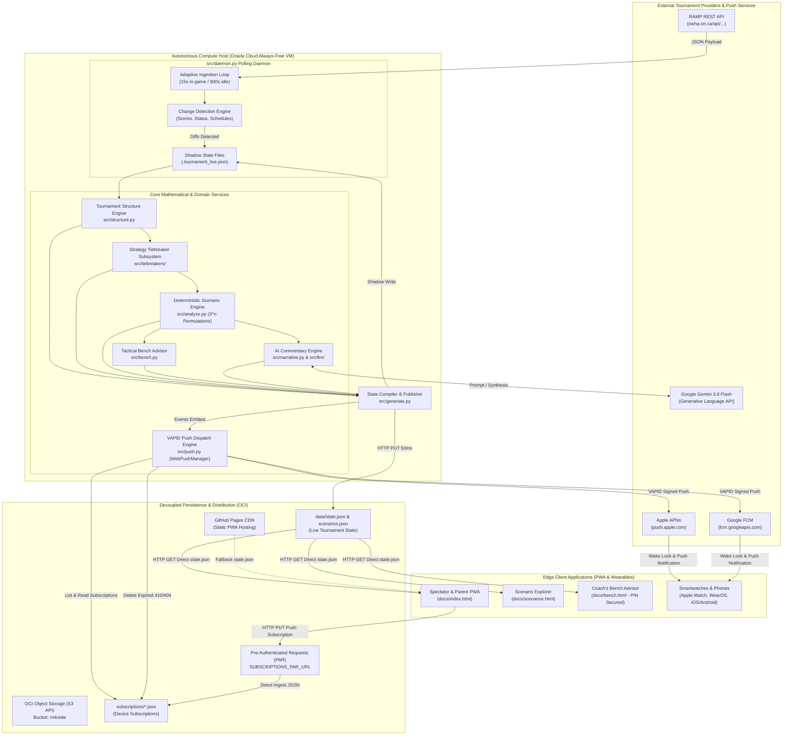
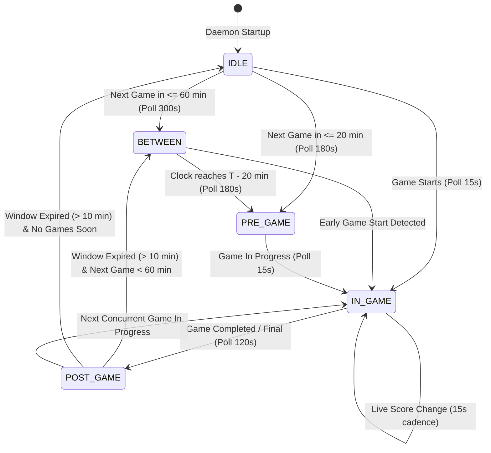
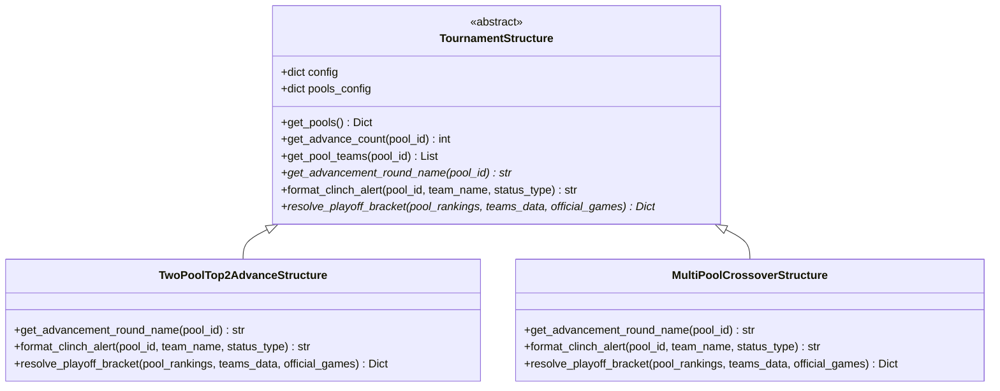
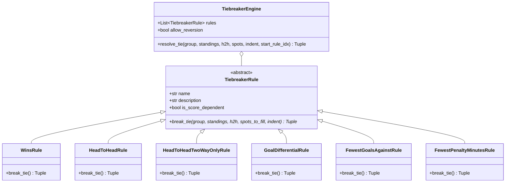
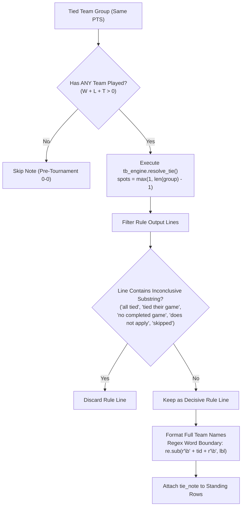
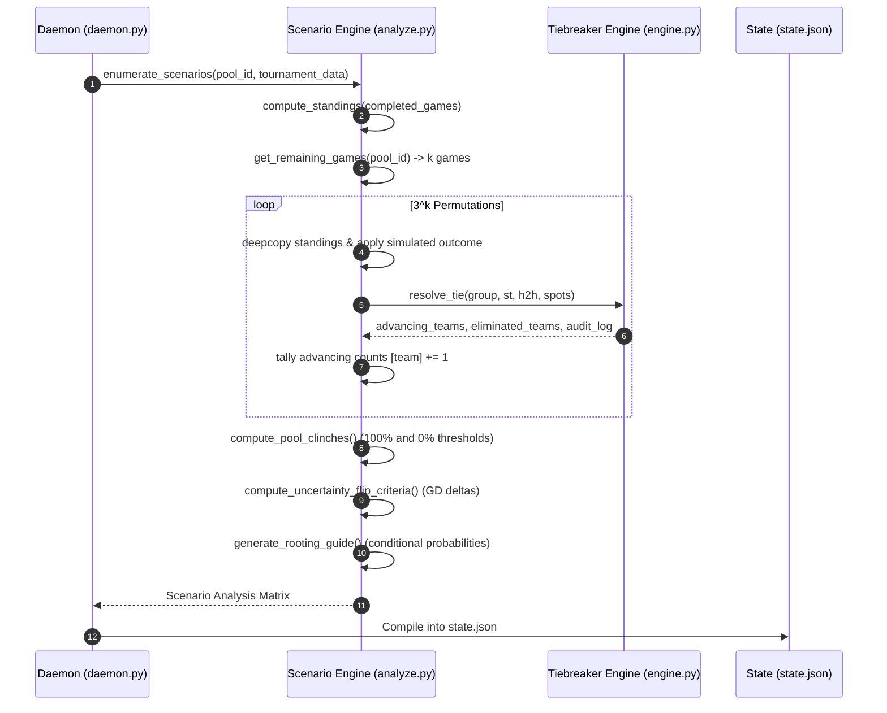
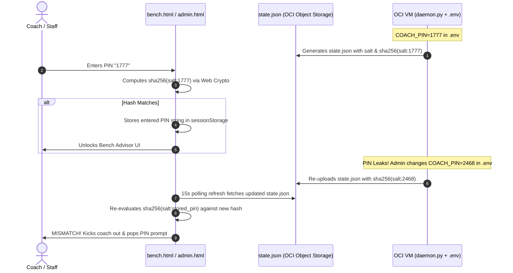
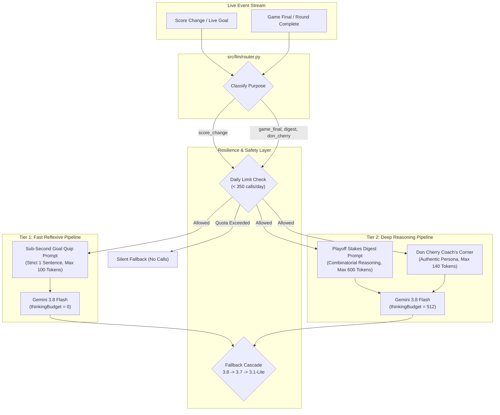

# Rinkside Tournament Platform — System Architecture & Technical Design

> **Production-Grade Technical Architecture Specification**  
> **System:** Rinkside Real-Time Minor Hockey Tournament Companion & Mathematical Clinch Engine  
> **Target Deployments:** OWHA Provincial Championships & Regional Invitational Tournaments (e.g., Pink the Rink XV)  
> **Author:** Antigravity AI Engineering Architecture Team  
> **Document Version:** 2.8.0 (Production Release)  
> **Status:** Active / Production  

---

## Table of Contents
1. [Executive Architecture Overview (Hybrid Cloud)](#1-executive-architecture-overview-hybrid-cloud)
2. [Data Ingestion & RAMP API Engine](#2-data-ingestion--ramp-api-engine)
3. [Tournament Domain Model & Polymorphic Structure Engine](#3-tournament-domain-model--polymorphic-structure-engine)
4. [Pluggable Strategy-Pattern Tiebreaker Subsystem & Standings Note Engine](#4-pluggable-strategy-pattern-tiebreaker-subsystem--standings-note-engine)
5. [Deterministic Scenario Permutation & Clinch Proof Engine](#5-deterministic-scenario-permutation--clinch-proof-engine)
6. [Tactical Bench Advisor & Goalie-Pull Matrix Calculus](#6-tactical-bench-advisor--goalie-pull-matrix-calculus)
7. [True VAPID Web Push Notification Subsystem (RFC 8292)](#7-true-vapid-web-push-notification-subsystem-rfc-8292)
8. [Hierarchical AI Commentary Engine](#8-hierarchical-ai-commentary-engine)
9. [Mobile-First PWA & Live Rink UX](#9-mobile-first-pwa--live-rink-ux)
10. [Autonomous Daemon Lifecycle, Simulation & DevOps Pipeline](#10-autonomous-daemon-lifecycle-simulation--devops-pipeline)
11. [System Verification & Testing Matrix](#11-system-verification--testing-matrix)

---

## 1. Executive Architecture Overview (Hybrid Cloud)

### 1.1 Core Architectural Philosophy
The Rinkside platform is designed around a fundamental principle: **"Heavy Autonomous Edge Compute, Zero-Maintenance High-Availability Client Delivery."**

Minor hockey tournaments (sanctioned by bodies such as the Ontario Women's Hockey Association - OWHA) create severe architectural demands:
- **Zero-Latency Spikes:** Sudden surges in traffic when games end and hundreds of parents, coaches, and scouts refresh standings simultaneously.
- **Rink Network Hostility:** Cold arena environments with spotty cellular data coverage, requiring lightweight, highly resilient client bundles.
- **Strict Budget Constraints:** Zero dedicated server operational budget, necessitating free-tier infrastructure that runs indefinitely without maintenance.
- **Mathematical Exactness:** Tiebreakers and elimination scenarios cannot be approximate; they must match governing rulebooks down to the goal differential, penalty minute, or coin toss.
- **Asynchronous Mobile Telemetry:** Parents and coaches cannot keep phones unlocked continuously; critical game events must wake up locked devices and smartwatches via true web push.

To meet these requirements, Rinkside implements a **Hybrid Cloud Architecture**:
1. **Autonomous Compute Daemon (OCI Always-Free VM):** An unattended Python daemon running on an Oracle Cloud Infrastructure (OCI) ARM/x86 Always-Free Compute instance (`ubuntu@132.145.100.44`). The daemon handles all data ingestion, network retry loops, $3^n$ scenario calculations, tiebreaker recursion, LLM synthesis, state compilation, and VAPID Web Push broadcasts.
2. **Decoupled Dual-Write Object Storage (OCI Object Storage / S3 API):** Through [`src/storage.py`](file:///home/dpauls/rangers-u15b-provincials-2026/src/storage.py), the engine writes state updates directly to OCI Object Storage with `no-cache, must-revalidate` cache control headers. Client devices fetch updates directly from object storage, achieving 50ms propagation without git commit latency.
3. **Serverless Ingestion via Pre-Authenticated Requests (PAR):** Devices register push subscriptions and livestream URLs directly to OCI Object Storage using scoped HTTPS PUT Pre-Authenticated Requests (`SUBSCRIPTIONS_PAR_URL`, `STREAMS_PAR_URL`), eliminating custom ingress API servers.
4. **High-Availability Edge PWA (GitHub Pages CDN + Edge Cache):** The static application shell and fallback state are published to GitHub Pages, backed by global CDN edge caching (Fastly/Edge), providing 100% serverless uptime, microsecond response times, and infinite read scalability with zero egress costs.

### 1.2 System Topology & Data Flow Diagram



### 1.3 Architecture Characteristics Matrix

| Dimension | Architectural Implementation | Operational Characteristic |
| :--- | :--- | :--- |
| **Compute Tier** | Python 3.12 Daemon in Docker on OCI VM | Self-healing (`restart: unless-stopped`), autonomous, persistent |
| **Storage Tier** | File-backed Shadow State + OCI Object Storage | Crash-resilient, git-pull safe, auditable history of every score change |
| **Push Delivery** | True VAPID Web Push (RFC 8292) via `pywebpush` | Directly reaches APNs/FCM; wakes locked phones and watches with 0 cloud server cost |
| **Edge Distribution**| Static CDN (GitHub Pages / Fastly Edge) | 0 ms cold starts, 99.999% availability, zero infrastructure maintenance |
| **Compute Scalability**| O(1) Client Serving Cost | Workload decoupled from traffic volume; 1 or 10,000 users cost $0 |
| **In-Game Polling** | 15-second active loop | Real-time score awareness within 15 seconds of official scorekeeper entry |
| **Combinatorics** | Exhaustive Cartesian product ($3^k$) | Deterministic mathematical proofs; 0% hallucination or probability guessing |
| **AI Inference** | Google Gemini 3.8 Flash (`thinkingBudget: 0 vs 512`) | Dual-speed: Sub-second live goal quips vs deep playoff stakes analysis |
| **Security Air-Gap** | Read-Only Client State + Salted SHA-256 PIN | Opponents cannot tamper with state; bench tactical notes are cryptographically locked |

---

## 2. Data Ingestion & RAMP API Engine

### 2.1 The RAMP REST Platform
The Ontario Women's Hockey Association uses the RAMP Interactive tournament management suite. Rather than fragile HTML web scraping, [`src/scraper.py`](file:///home/dpauls/rangers-u15b-provincials-2026/src/scraper.py) communicates directly with RAMP's internal RESTful JSON endpoints utilized by their front-end web portal.

#### Primary Ingestion Endpoints
```http
# 1. Division Schedule & Live Game Scores
GET https://www.owha.on.ca/api/leaguegame/get/{league_id}/{season_id}/0/{division_id}/{game_type}/0/0

# 2. Pool-Structured Division Standings (Cached Server-Side)
GET https://www.owha.on.ca/api/leaguegame/getstandings3wsdcached/{league_id}/{season_id}/0/0/{division_id}/0

# 3. Playoff & Bracket Games (Finals / Bronze)
GET https://www.owha.on.ca/api/leaguegame/get/{league_id}/{season_id}/0/{division_id}/5384/0/0  (Finals)
GET https://www.owha.on.ca/api/leaguegame/get/{league_id}/{season_id}/0/{division_id}/5428/0/0  (Bronze)
```

### 2.2 Network Hardening & Anti-Blocking Measures
Tournament networks and RAMP servers frequently exhibit transient routing drops, SSL expiration on regional municipal subdomains, and sudden rate-limiting spikes. `src/scraper.py` implements a robust network defense stack:

1. **Browser Fingerprint Emulation:** All requests carry modern browser user agents (`Chrome/124.0.0.0 Safari/537.36`) and standard `Accept: application/json, text/plain, */*` headers, bypassing naive bot blockers.
2. **Municipal SSL Bypass:** Municipal arenas often run custom reverse proxies with expired root certificates. An unverified default SSL context (`ssl.CERT_NONE`) guarantees connectivity is never severed by municipality SSL misconfigurations.
3. **Exponential Backoff with Full Jitter:**
   $$\text{Delay}_i = \text{RETRY\_DELAYS}[i] + \text{Uniform}(0.1, 0.4)$$
   Retries transient HTTP errors (`429`, `500`, `502`, `503`, `504`), socket timeouts (12s threshold), and connection resets across 5 attempts (`[0.5s, 1.0s, 1.5s, 2.0s, 3.0s]`).
4. **Transient 404 Resilience:** RAMP's internal load balancers occasionally return transient `404 Not Found` responses when syncing new divisions. The scraper performs targeted short-delay retries on 404s before concluding an endpoint is genuinely absent.

### 2.3 Adaptive Polling Loop State Machine
The daemon ([`src/daemon.py`](file:///home/dpauls/rangers-u15b-provincials-2026/src/daemon.py)) optimizes API call efficiency using an adaptive polling state machine:



#### Polling Cadence Definitions
- **`POLL_INGAME` (15 seconds):** Active when any game in the division has `status == 'in_progress'` or `liveScores == True`. Ensures rinkside score changes appear almost immediately on parents' phones.
- **`POLL_POSTGAME` (120 seconds):** Active for 10 minutes immediately after a game goes final to capture post-game score corrections, official stat sheet sign-offs, and penalty minute uploads.
- **`POLL_PREGAME` (180 seconds):** Active within 20 minutes of scheduled game start to detect early puck-drops.
- **`POLL_BETWEEN` (300 seconds):** Active during intermission breaks between games (within 60 minutes).
- **`POLL_IDLE` (900 seconds / 15 minutes):** Overnight or morning hibernation when no games are scheduled for hours.

### 2.4 Shadow File State Integrity
A major vulnerability in continuous-deployment daemons is local state corruption caused by git operations (e.g., `git pull`, `git checkout`). If an operator pulls updates to code while a live game is being tracked, an uncommitted `state.json` or `tournament.json` would be overwritten or cause git merge conflicts.

Rinkside resolves this with **Shadow File Architecture**:
```
Live State (Gitignored, Single Source of Truth):
  ├── data/.tournament_live.json
  └── docs/data/.state_live.json

Tracked Distribution Artifacts (Committed & Published):
  ├── data/tournament.json
  └── docs/data/state.json
```
- The daemon reads and writes exclusively to the hidden shadow files during all polling and simulation cycles.
- When and only when a push to GitHub is warranted, `_publish_to_git()` copies shadow files over the tracked files via atomic filesystem operations (`shutil.copy2`) before executing `git commit` and `git push`.
- Operators can run `git pull origin main` on the host VM at any time without terminating the daemon or corrupting live in-game data.

---

## 3. Tournament Domain Model & Polymorphic Structure Engine

### 3.1 Domain Model Design
The tournament architecture abstracts tournament rules, divisional setups, and advancement criteria into a modular structure managed by [`src/structure.py`](file:///home/dpauls/rangers-u15b-provincials-2026/src/structure.py).



### 3.2 Supported Tournament Formats
The polymorphic structure engine supports arbitrary multi-pool configurations:

#### 1. Two-Pool Top-2 Advance (`TwoPoolTop2AdvanceStructure`)
- **Use Case:** Regional Invitational Tournaments (e.g., Pink the Rink XV U18C).
- **Format:** 2 pools (Pool A, Pool B) of 4 teams each (8 teams total).
- **Advancement:** Top 2 teams from each pool advance to Semifinals; 3rd and 4th place teams advance to Consolation brackets.
- **Matchup Mapping:**
  - **Semi 1:** 1st in Pool A vs. 2nd in Pool B
  - **Semi 2:** 1st in Pool B vs. 2nd in Pool A
  - **Consolation 1:** 3rd in Pool A vs. 3rd in Pool B
  - **Consolation 2:** 4th in Pool A vs. 4th in Pool B
  - **Championship Final:** Winner Semi 1 vs. Winner Semi 2

#### 2. Multi-Pool Crossover (`MultiPoolCrossoverStructure`)
- **Use Case:** OWHA Provincial Championships (e.g., U15B Provincials).
- **Format:** 4 to 8 pools of 3–5 teams each (e.g., 8 pools of 4 = 32 teams).
- **Advancement:** Exactly 1 team (the pool winner) advances to the Quarterfinals.
- **Crossover Pairing:** Configured dynamically via JSON (e.g., Winner Pool A vs. Winner Pool H, Winner Pool B vs. Winner Pool G, etc.).

### 3.3 Dynamic Playoff Bracket Resolution
The bracket resolution engine operates in four discrete state phases per matchup slot:
- `tbd`: Neither team has clinched; displayed with placeholder labels (e.g., `"1st in Pool A"`).
- `partial`: One team has clinched their seeding, awaiting their opponent.
- `clinched`: Both seeds are mathematically locked prior to pool play completion.
- `final`: All pool games are final and seeds are official.

---

## 4. Pluggable Strategy-Pattern Tiebreaker Subsystem & Standings Note Engine

### 4.1 Subsystem Design (`src/tiebreakers/`)
Tournament tiebreakers are notoriously fraught with misinterpretation, conflicting interpretations between head-to-head and goal differential, and operator confusion. Rinkside implements a pluggable **GoF Strategy Pattern** in [`src/tiebreakers/`](file:///home/dpauls/rangers-u15b-provincials-2026/src/tiebreakers/):



### 4.2 Rules Registry & Concrete Implementations

| Rule Key | Class | Rulebook Logic | Score Dep? |
| :--- | :--- | :--- | :---: |
| `wins` | `WinsRule` | Most total wins in round-robin play. | No |
| `head_to_head` | `HeadToHeadRule` | Standard OWHA rule: Points in games between all tied teams (mini-table). | No |
| `head_to_head_two_way_only` | `HeadToHeadTwoWayOnlyRule` | **Pink the Rink Rule 16b:** H2H applies **if and only if exactly 2 teams are tied**. If >2 teams tied, rule is explicitly skipped. | No |
| `goal_diff` | `GoalDifferentialRule` | Goal differential: $\text{GF} - \text{GA}$ across all round-robin games. | **Yes** |
| `fewest_goals_against` | `FewestGoalsAgainstRule`| Fewest total goals allowed ($\text{GA}$) across round-robin games. | **Yes** |
| `fewest_pim` | `FewestPenaltyMinutesRule` | Fewest total penalty minutes ($\text{PIM}$). | No |

### 4.3 Deep Dive: Pink the Rink Rule 16 vs. Standard OWHA

#### 1. Two-Way vs. Multi-Team Head-to-Head
In standard OWHA championship rules, when 3 teams are tied, a mini-table of games played between those 3 teams is calculated. In contrast, **Pink the Rink Rule 16b** explicitly commands:
> *"Head-to-head record (this applies only if two teams are tied; if more than two teams are tied, this criterion does not apply and the tiebreaker moves immediately to goal differential)."*

If Team A, Team B, and Team C are tied with circular wins (A beat B, B beat C, C beat A), `HeadToHeadTwoWayOnlyRule` detects `len(group) > 2`, emits an audit trace:
`"Rule (h2h 2-way only): 3 teams tied — criterion does NOT apply (skipped)"`, and passes the entire group directly to Goal Differential without discarding H2H prematurely for future 2-way ties.

#### 2. Raw Goal Differential vs. Goal Percentage
- **Standard OWHA Provincials Formula:** 
  $$\text{Ratio} = \frac{\text{GF}}{\text{GF} + \text{GA}}$$
- **Pink the Rink Rule 16c Formula:**
  $$\text{GD} = \text{GF} - \text{GA}$$
Rinkside implements raw $\text{GF} - \text{GA}$ as defined by the tournament's specific sanctions, preventing erroneous seedings that occur when using ratio calculations on minor hockey scores.

#### 3. Non-Reverting Rule Chains (`allow_reversion = False`)
A critical edge case in tournament tiebreakers: If 3 teams are tied for 2 spots, and Rule 3 (Goal Differential) identifies the 1st place team (advancing them), how are the remaining 2 teams evaluated for the final spot?
- Under **Reverting rules** (`allow_reversion = True`), the engine starts over at Rule 1 (Wins / H2H) for the remaining 2 teams.
- Under **Non-Reverting rules** (`allow_reversion = False` - mandated by Pink the Rink Rule 16), the remaining teams **continue forward** to Rule 4 (Fewest Goals Against). They never revert to earlier rules.

```python
# From src/tiebreakers/engine.py (lines 69-73)
next_idx = 0 if self.allow_reversion else r_idx + 1
sub_a, sub_e, sub_lines, sub_score_dep, sub_unres = self.resolve_tie(
    subg, standings, h2h, rem_spots, indent + '    ', next_idx
)
```

### 4.4 Automated Source Citation & Verification
Every tournament configuration JSON (`data/tournaments/*.json`) mandates a `tiebreakers` object containing full administrative citations:
```json
"tiebreakers": {
  "source_name": "Pink the Rink XV Tournament Rules (Rule 16)",
  "source_url": "https://etobicokedolphins.ca/Public/Documents/Pink_the_Rink_XV_Tournament_RULES_2026.pdf",
  "rules": [
    "wins",
    "head_to_head_two_way_only",
    "goal_diff",
    "fewest_goals_against",
    "fewest_pim"
  ],
  "allow_reversion": false
}
```
This metadata is exposed directly in the UI footer and tiebreaker modals, providing coaches and parents with instant, authoritative rule citations during disputed rinkside decisions.

### 4.5 Standings Tiebreaker Note Engine & Decisive Rule Selector (`src/generate.py`)
Standings tables frequently display teams tied on points (e.g., Kanata and Belmont tied at 2 PTS after 1 win each). Previous reporting systems dumped the entire evaluation log into the standings row, including inconclusive rules (e.g. *"Rule (wins): All tied with 1; Rule (h2h): No completed game; Rule (goal diff): Kanata +2 over Belmont +1"*), creating visual noise.

[`build_standings()`](file:///home/dpauls/rangers-u15b-provincials-2026/src/generate.py#L42) implements the **Decisive Rule Selector Algorithm**:



1. **Active Play Verification & 0-Point Tie Resolution:**
   ```python
   has_played = any(st[t]['W'] + st[t]['L'] + st[t]['T'] > 0 for t in group)
   if len(group) <= 1 or not has_played:
       continue
   ```
   Before tournament games begin, 0-point ties are unannotated. However, once tournament play is underway, teams tied at 0 points (e.g. 0-1 records) are differentiated by Goal Differential, Goals Against, or H2H. The `has_played` check ensures 0-point ties are correctly resolved and explained (e.g., Wilmot Wolverine -1 GD ranked 3rd over Nepean Wildcats -2 GD ranked 4th).
2. **Decisive Rule Filtering:**
   The algorithm isolates the exact criterion that broke the tie by filtering out all neutral/inconclusive lines:
   ```python
   decisive_lines = []
   for line in lines:
       line = line.strip()
       if not line.startswith('Rule '):
           continue
       lower = line.lower()
       if any(skip in lower for skip in ['all tied', 'tied their game', 'no completed game', 'does not apply', 'skipped']):
           continue
       decisive_lines.append(line)
   ```
3. **Full Team Name Substitution:**
   Raw internal team keys (`KAN`, `BEL`, `WIL`) are substituted with user-facing full names using exact regex word boundaries:
   ```python
   if decisive_lines:
       note = '; '.join(decisive_lines)
       for tid in group:
           t_meta = teams.get(tid, {})
           lbl = t_meta.get('short_name') or t_meta.get('name', tid)
           note = re.sub(r'\b' + re.escape(tid) + r'\b', lbl, note)
   ```
   This generates clear, authoritative notes in the standings:
   `"Rule (goal diff): Kanata Rangers (+2) over Belmont Blazers (+1)"`.

---

## 5. Deterministic Scenario Permutation & Clinch Proof Engine

### 5.1 Combinatorial Explosion Calculus ($3^n$)
In a 4-team pool with 6 total games, each game can end in one of 3 discrete outcomes:
$$\Omega = \{\text{Home Win}, \text{Tie}, \text{Away Win}\}$$
For $k$ remaining games, the total possible scenario space $\mathcal{S}$ is:
$$|\mathcal{S}| = 3^k$$

| Remaining Games ($k$) | Scenario Space ($3^k$) | Compute Time (Python 3.12) |
| :--- :---: | :---: | :---: |
| 6 (Tournament Start) | 729 | 18 ms |
| 5 | 243 | 6 ms |
| 4 | 81 | 2 ms |
| 3 | 27 | < 1 ms |
| 2 | 9 | < 0.5 ms |
| 1 | 3 | < 0.1 ms |

Because $k \le 6$ across all round-robin pools, Rinkside does **not** rely on stochastic Monte Carlo sampling or approximate probabilities. It enumerates the complete Cartesian product $\prod_{i=1}^k \{0, 1, 2\}$ deterministically on every polling cycle using `itertools.product`.



### 5.2 Mathematical Clinch Proofs
A team's playoff qualification status is mathematically proven across all possible future worlds $\mathcal{S}$:
- **Clinched 1st Place:**
  $$\text{ClinchedFirst}(T) \iff \forall s \in \mathcal{S}, \quad \text{Rank}(T, s) = 1$$
- **Clinched Playoff Berth:**
  $$\text{ClinchedPlayoff}(T) \iff \forall s \in \mathcal{S}, \quad \text{Rank}(T, s) \le \text{AdvanceCount}$$
- **Mathematically Eliminated:**
  $$\text{Eliminated}(T) \iff \forall s \in \mathcal{S}, \quad \text{Rank}(T, s) > \text{AdvanceCount}$$

If a team finishes in an advancing spot in 80 out of 81 scenarios, Rinkside reports their advancement odds as **98.8%**, but strictly **refuses** to emit a clinch badge until the count reaches $81 / 81$ (100.0%).

### 5.3 Goal Differential Margin Flip Thresholds
When tiebreakers reach score-dependent rules (`GoalDifferentialRule` or `FewestGoalsAgainstRule`), simulated games apply a baseline 1-goal victory margin. However, actual games can end with larger margins.

To prevent parents from being blindsided by score differentials, [`compute_uncertainty_flip_criteria()`](file:///home/dpauls/rangers-u15b-provincials-2026/src/analyze.py#L262) computes the exact **Goal Differential Margin Flip Threshold**:
$$\Delta_{\text{required}} = (GD_{\text{advancing}} - GD_{\text{eliminated}}) + 1$$

The engine formulates dynamic, human-readable threshold statements embedded in the UI:
- *"Kanata holds spot unless Belmont victory margin exceeds Kanata victory margin by $\ge 3$ goals."*
- *"East Ottawa advances if victory margin exceeds Woodstock margin by $\ge 1$ goal."*

### 5.4 Concurrent Game Rooting Guide
Spectating parents often wonder who to cheer for in games taking place on adjacent rink pads. [`generate_rooting_guide()`](file:///home/dpauls/rangers-u15b-provincials-2026/src/analyze.py#L330) evaluates all concurrent external games ($g \notin \text{our\_games}$) and computes the conditional probability of our team advancing under each outcome:

$$\text{Swing} = \max\left(P(\text{adv} \mid H_{\text{win}}), P(\text{adv} \mid \text{Tie}), P(\text{adv} \mid A_{\text{win}})\right) - \min\left(P(\text{adv} \mid H_{\text{win}}), P(\text{adv} \mid \text{Tie}), P(\text{adv} \mid A_{\text{win}})\right)$$

The guide outputs actionable spectator recommendations:
> **Root for Wilmot Wolverine:** Gives Kanata **100.0%** advancement odds vs. **44.4%** if Belmont Blazers win (Swing: **55.6%**).

---

## 6. Tactical Bench Advisor & Goalie-Pull Matrix Calculus

### 6.1 Rationale & Problem Formulation
In the final 3 minutes of the 3rd period, a minor hockey coach trailing by 1 goal faces a high-stakes tactical dilemma: **Should they pull their goaltender for a 6-on-5 extra attacker?**

In league play, pulling the goalie is an easy decision (a loss is a loss). In tournament play governed by Goal Differential tiebreakers, **pulling the goalie can be fatal**. Conceding an empty-net goal changes a $-1$ loss into a $-2$ loss. If the team is later tied in points with another team, that 1 extra goal against can eliminate them from playoff contention.

[`src/bench.py`](file:///home/dpauls/rangers-u15b-provincials-2026/src/bench.py) implements the **Goalie-Pull Decision Calculus** to give coaches instant, objective guidance on the bench.

```mermaid
flowchart TD
    Start["Coach Checks Bench Advisor (/bench.html)"] --> ScoreCheck{"Current Score Margin?"}

    ScoreCheck -->|Leading by >= 2| GreenLead["GREEN: Protect Lead<br/>Maintain defensive structure. Do NOT pull."]
    ScoreCheck -->|Leading by 1| Green1Lead["GREEN: Protect 1-Goal Lead<br/>Manage puck, avoid penalties. Do NOT pull."]
    ScoreCheck -->|Tied (Diff == 0)| TieCheck{"Does a Tie Guarantee Berth?"}
    ScoreCheck -->|Trailing by 1 (Diff == -1)| DownsideCheck{"Empty-Net Downside Risk?"}
    ScoreCheck -->|Trailing by 2 (Diff == -2)| RedUrgency["RED: Down 2 — Urgency Required<br/>Need quick goal before pulling goalie late."]
    ScoreCheck -->|Trailing by >= 3| RedCeiling["RED: Deficit Ceiling<br/>Protect GD. Pulling risks blowout."]

    TieCheck -->|Advancement on Tie == 100%| GreenTie["GREEN: Hold the Tie<br/>Tie guarantees advancement. Zero risk."]
    TieCheck -->|Advancement on Tie == 0%| RedMustWin["RED: Must Win Regulation<br/>Tie eliminates us. PULL GOALIE LATE."]
    TieCheck -->|0% < Adv < 100%| YellowTie["YELLOW: Tough Call<br/>Evaluate concurrent game score."]

    DownsideCheck -->|P(Loss -1) == 0%| RedPull["RED: Pull Goalie Late (Zero Downside)<br/>Regulation loss eliminates team anyway (0%).<br/>Empty-net goal carries 0 penalty!"]
    DownsideCheck -->|P(Loss -2) < P(Loss -1)| YellowCaution["YELLOW: High Downside Risk<br/>Empty-net goal drops odds from 40% to 0%.<br/>Protect GD unless tie is mandatory!"]
    DownsideCheck -->|P(Loss -1) > 0% and P(-2) == P(-1)| YellowGDCaution["YELLOW: GD Caution<br/>Odds equal in this round, but permanently damages<br/>tournament GD for later tiebreakers."]
```

### 6.2 Realistic Deficit Simulation Model & Score Margin Payoff Matrix ($-3$ to $+3$)
In earlier naive implementations, margin simulations assumed static hypothetical scorelines (e.g. simulating `1-2` for -1 and `1-3` for -2), irrespective of current game scores. If the live game was already 3-4 or 0-2, static assumptions produced synthetic goals that were impossible given the game's actual progression, generating misleading identical odds across different loss margins.

[`compute_margin_payoff_matrix()`](file:///home/dpauls/rangers-u15b-provincials-2026/src/bench.py#L14) implements a **Realistic Deficit Simulation Model** that strictly respects goals already scored on ice:

```python
# From src/bench.py (lines 41-46)
for margin in range(-3, 4):
    # Calculate realistic simulated scores respecting current goals:
    # our_sim - opp_sim == margin
    # our_sim >= our_cur, opp_sim >= their_cur
    opp_sim = max(their_cur, our_cur - margin)
    our_sim = opp_sim + margin
```

#### Realistic Score Progression When Trailing 1-2 (`our_cur = 1`, `their_cur = 2`):
- **Margin $-3$ (Lose by 3):** `opp_sim = max(2, 1 - (-3)) = 4`, `our_sim = 4 + (-3) = 1` $\rightarrow$ Simulates score **1-4** (conceding 2 empty-net goals).
- **Margin $-2$ (Lose by 2):** `opp_sim = max(2, 1 - (-2)) = 3`, `our_sim = 3 + (-2) = 1` $\rightarrow$ Simulates score **1-3** (conceding 1 empty-net goal).
- **Margin $-1$ (Lose by 1):** `opp_sim = max(2, 1 - (-1)) = 2`, `our_sim = 2 + (-1) = 1` $\rightarrow$ Simulates score **1-2** (current regulation score holds).
- **Margin $0$ (Tie):** `opp_sim = max(2, 1 - 0) = 2`, `our_sim = 2 + 0 = 2` $\rightarrow$ Simulates score **2-2** (extra attacker scores tying goal).
- **Margin $+1$ (Win by 1):** `opp_sim = max(2, 1 - 1) = 2`, `our_sim = 2 + 1 = 3` $\rightarrow$ Simulates score **3-2** (complete comeback win).

Every simulated outcome guarantees $GF \ge GF_{\text{current}}$ and $GA \ge GA_{\text{current}}$, providing mathematically sound inputs for scenario permutations and tiebreakers.

### 6.3 Empty-Net Downside Risk Analysis & False 'Zero Downside' Elimination
A major hazard in automated coaching software is issuing false "Zero Downside" advice. If a team trails by 1 and $P(\text{advance} \mid \text{margin} = -2) == P(\text{advance} \mid \text{margin} = -1) = 33\%$, a naive algorithm might declare "Zero Downside!" because the advancement probability did not drop in the current permutation count. In reality, conceding an empty-net goal damages tournament Goal Differential across future rounds and other tiebreaker chains.

[`evaluate_goalie_pull()`](file:///home/dpauls/rangers-u15b-provincials-2026/src/bench.py#L100) strictly enforces three boundary conditions:

1. **True Zero Downside ($P(\text{Loss } -1) == 0.0\%$):**
   Only when a 1-goal regulation loss completely eliminates the team ($0.0\%$ survival) does the system issue zero-downside guidance:
   ```python
   if p_minus_1 == 0.0:
       empty_net_downside = False
       empty_net_warning = (
           "ZERO DOWNSIDE: Any regulation loss eliminates our team (0%). "
           "Push aggressively for the tying goal—an empty-net goal carries no advancement penalty."
       )
       recommendation = "Pull Goalie Late"
       indicator = "red"
   ```
2. **High Downside Risk ($P(\text{Loss } -2) < P(\text{Loss } -1)$):**
   When conceding an empty-net goal directly drops advancement odds:
   ```python
   elif p_minus_2 < p_minus_1:
       empty_net_downside = True
       empty_net_warning = (
           f"HIGH DOWNSIDE: Conceding an empty-net goal (-2 margin) drops advancement odds "
           f"from {p_minus_1}% to {p_minus_2}%. Protect GD unless tie is mandatory."
       )
       recommendation = "Caution on Goalie Pull"
       indicator = "yellow"
   ```
3. **Goal Differential Caution ($P(\text{Loss } -1) > 0.0\%$ and $P(\text{Loss } -2) == P(\text{Loss } -1)$):**
   When the immediate scenario count does not drop, but the team still has playoff life ($P > 0$):
   ```python
   else:
       empty_net_downside = True
       empty_net_warning = (
           f"GD CAUTION: Losing by 2 has similar base scenario odds as losing by 1 ({p_minus_1}%), "
           f"but permanently damages tournament Goal Differential for later tiebreakers."
       )
       recommendation = "Caution on Goalie Pull"
       indicator = "yellow"
   ```
4. **Leading Score Protection:**
   When leading (`diff >= 1`), empty-net warnings are suppressed (`empty_net_warning = None`), and advice strictly commands protecting the lead without pulling the goaltender.

### 6.4 Dynamic Salted SHA-256 PIN Security & Invalidation
Tactical bench advice must not fall into the hands of opposing teams or casual spectators. However, hardcoding PINs in client-side code or storing raw boolean flags (`is_authenticated = true`) creates significant security flaws:
1. Anyone inspecting `state.json` or source code could read the PIN.
2. If a PIN leaked and was changed on the server, previously authenticated browsers remained permanently unlocked.

To eliminate both vulnerabilities, Rinkside implements an **Environment-Driven, Salted SHA-256 Hash Architecture with Dynamic Client Invalidation**:



1. **Server-Side Hash Computation (`src/generate.py`):**
   Pins are configured per deployment in `.env` (`COACH_PIN=1777`, `ADMIN_PIN=9876`). The generator reads the active tournament salt (e.g., `salt = "ptr_2026_u18c"`) and computes:
   $$\text{coach\_pin\_hash} = \text{SHA-256}(\text{salt} + \text{":"} + \text{COACH\_PIN})$$
   $$\text{admin\_pin\_hash} = \text{SHA-256}(\text{salt} + \text{":"} + \text{ADMIN\_PIN})$$
   Only the salt and hex digests are published in `state.json`. Plaintext PINs are **never** committed or exposed over the wire.
2. **Client-Side Comparison (`bench.html` & `admin.html`):**
   The browser uses the native Web Crypto API (`crypto.subtle.digest('SHA-256', ...)`) to hash the user's input.
3. **Dynamic Invalidation:**
   The browser persists **only the entered PIN string** (scoped to tournament and team ID), never a raw authenticated boolean. On every 15-second data refresh, the browser re-hashes the stored PIN against the latest hash from OCI Object Storage. If you update `.env` on the VM, every client is immediately kicked out on their next poll.

### 6.5 Live Stream Broadcast Management (`docs/admin.html`)
To allow team staff or volunteers to attach YouTube livestream URLs directly from the arena concourse without requiring terminal or SSH access:
1. **Admin Console (`docs/admin.html`):** Protected by `ADMIN_PIN`. Displays all division games with live/scheduled badges and a stream URL input box.
2. **Pre-Authenticated Request (PAR) Ingestion:** When an admin saves a stream URL, the browser issues an HTTPS `PUT` of the updated streams dictionary to an OCI Pre-Authenticated Request URL (`STREAMS_PAR_URL`).
3. **Autonomous Synchronization:** The background daemon on the VM monitors the object storage `streams.json`. When a change is detected, it immediately updates `state.json` and pushes to OCI Object Storage, displaying the red `▶ Stream` badge across all spectator PWAs within seconds.
4. **CLI Alternative:** Terminal access via `python3 src/stream.py <game_id> <url>` remains fully functional as a local or SSH fallback.

---

## 7. True VAPID Web Push Notification Subsystem (RFC 8292)

### 7.1 Architecture & Standards Overview
Prior to this subsystem, web notifications relied entirely on foreground client polling: if a parent closed their browser tab or locked their phone screen, alerts were never delivered.

Rinkside implements a production-grade, zero-maintenance **True VAPID Web Push Notification Subsystem** compliant with **RFC 8292 (Voluntary Application Server Identification for Web Push)** and **RFC 8030 (Web Push Protocol)**. Notifications are pushed directly into native device push gateways:
- **Apple Push Notification service (APNs)** for iOS Safari and Apple Watch (`https://*.push.apple.com/...`).
- **Google Firebase Cloud Messaging (FCM)** for Android and Google Chrome (`https://fcm.googleapis.com/...`).

```mermaid
sequenceDiagram
    autonumber
    actor Spectator as Parent / Coach
    participant Browser as Spectator PWA (sw.js)
    participant PushMgr as PushManager API
    participant PAR as OCI Storage PAR (subscriptions/)
    participant Daemon as OCI VM (push.py + pywebpush)
    participant Gateway as Apple APNs / Google FCM
    participant Watch as Smart Watch / Phone Lockscreen

    Spectator->>Browser: Taps "🔔 Watch Alerts: ON" or "🔕 Alert me"
    Browser->>PushMgr: registration.pushManager.subscribe(applicationServerKey)
    PushMgr-->>Browser: PushSubscription (endpoint, p256dh, auth keys)
    Browser->>PAR: HTTPS PUT /subscriptions/{device_id}.json
    Note over PAR: Serverless persistence in OCI Object Storage!

    loop Daemon 15s Polling Loop
        Daemon->>Daemon: RAMP API detects Goal / Start / Final event
        Daemon->>PAR: list_objects_v2(Prefix='subscriptions/')
        PAR-->>Daemon: List of active subscriber JSON payloads
        Daemon->>Daemon: Match event against subscriber filters (games / all)
        Daemon->>Daemon: Sign payload with VAPID P-256 private key
        Daemon->>Gateway: POST https://gateway/send (RFC 8292 JWT)
        alt Token Expired (HTTP 410 Gone / 404)
            Gateway-->>Daemon: 410 Gone
            Daemon->>PAR: delete_object(subscriptions/{device_id}.json)
        else Delivery Success
            Gateway-->>Daemon: 201 Created
            Gateway->>Watch: WAKE UP & Push Alert!
            Watch->>Watch: 5-pulse haptics [200, 100, 200, 100, 200]
            Watch->>Watch: Display association icon & score badge
        end
    end
```

### 7.2 VAPID P-256 Keypair Generation & Configuration
The cryptographic trust boundary between Rinkside and push services is rooted in an Elliptic Curve P-256 (prime256v1) keypair:
1. **Private Key (`data/vapid_private.pem`):** SEC1 PEM-encoded private key stored on the OCI VM host. Generated via OpenSSL:
   ```bash
   openssl ecparam -name prime256v1 -genkey -noout -out data/vapid_private.pem
   ```
2. **Public Key (`VAPID_PUBLIC_KEY`):** The raw 65-byte uncompressed EC point encoded in URL-safe base64:
   ```
   BMHZQb_FrawdIMHMPgbeJ80lwbKy92tshW_QC8ba5_tP-sK7yArf7N9AufQpM53Iyad5Y8i5C8v2yHL_Pm-wlkI
   ```
3. **VAPID Claims (`VAPID_CLAIM_EMAIL`):** Identifies the operator contact (`mailto:tracker@rinkside.ca`) passed in the JWT `sub` claim per RFC 8292 Section 2.1.
4. **Distribution via `state.json`:** The public key is serialized into `state.json` (`auth.vapid_public_key`), allowing browser clients to initialize push subscriptions without hardcoded secrets.

### 7.3 Serverless Subscription Ingestion via OCI Object Storage PAR (`SUBSCRIPTIONS_PAR_URL`)
A typical push notification architecture requires a persistent API server (e.g. Node.js/FastAPI) and a database (PostgreSQL/Redis) solely to store device push tokens. In Rinkside, this is eliminated using **OCI Object Storage Pre-Authenticated Requests (PAR)**:

1. **Storage Bucket Prefix:** Subscriptions are stored as isolated JSON documents under the `subscriptions/` bucket prefix in OCI Object Storage.
2. **PAR URL (`SUBSCRIPTIONS_PAR_URL`):** A scoped Pre-Authenticated Request with Object Read/Write permissions on the `subscriptions/` prefix is published via `.env`.
3. **Client-Side Registration ([`registerWebPushSubscription()`](file:///home/dpauls/rangers-u15b-provincials-2026/docs/index.html#L995)):**
   ```javascript
   // Client converts public key to Uint8Array and subscribes
   const reg = await navigator.serviceWorker.ready;
   let sub = await reg.pushManager.getSubscription();
   if (!sub) {
       sub = await reg.pushManager.subscribe({
           userVisibleOnly: true,
           applicationServerKey: urlBase64ToUint8Array(vapidKey)
       });
   }

   // Generates or retrieves stable device ID
   let deviceId = localStorage.getItem('rinkside_device_id') || ('dev_' + Math.random().toString(36).substring(2, 12));
   localStorage.setItem('rinkside_device_id', deviceId);

   // Direct HTTPS PUT to OCI Object Storage PAR
   await fetch(`${parUrl}/subscriptions/${deviceId}.json`, {
       method: 'PUT',
       headers: { 'Content-Type': 'application/json' },
       body: JSON.stringify({
           subscription: sub.toJSON(),
           games: getGameSubs(),
           alerts_enabled: alertsEnabled,
           device_id: deviceId,
           updated_at: new Date().toISOString()
       })
   });
   ```
This provides 100% serverless, zero-maintenance device ingestion with zero compute attack surface.

### 7.4 Backend Dispatch Engine (`src/push.py` + `WebPushManager`)
The push engine ([`WebPushManager`](file:///home/dpauls/rangers-u15b-provincials-2026/src/push.py#L20)) executes inside the OCI VM daemon during every active polling cycle when live match events are detected:

1. **Subscriber Discovery:** Calls `s3_client.list_objects_v2(Bucket=s3_bucket, Prefix='subscriptions/')` to retrieve all active device registrations.
2. **Targeted Event Filtering:** Evaluates event type and headline:
   - Event types: `goal`, `final`, `start`.
   - Headline keywords: `STARTED`, `FINAL`, `SCORE UPDATE`.
3. **Granular Subscription Matching:**
   ```python
   # From src/push.py (lines 148-154)
   for sub in subs:
       alerts_enabled = sub.get('alerts_enabled', True)
       subbed_games = [str(g) for g in sub.get('games', [])]
       
       is_subbed = bool(game_id and game_id in subbed_games)
       if not (alerts_enabled or is_subbed):
           continue
   ```
   A subscriber receives the notification if **General Alerts** are enabled (`alerts_enabled: true`) OR if they explicitly subscribed to that specific **Game ID** (`is_subbed: true`).
4. **RFC 8292 Cryptographic Signing (`pywebpush`):**
   ```python
   pywebpush.webpush(
       subscription_info=sub_info,
       data=json.dumps(payload),
       vapid_private_key=str(Path(self.private_key_path).resolve()),
       vapid_claims={"sub": self.claim_email}
   )
   ```
   The engine signs an ECDSA P-256 JWT containing the audience (`aud = https://push.apple.com`), expiration, and subject claims, delivering the payload securely to APNs or FCM.

### 7.5 Self-Cleaning Endpoint Lifecycle (HTTP 410 Gone / 404 Purge)
When a user uninstalls the PWA, resets browser data, or revokes notification permissions, push services reject delivery with `HTTP 410 Gone` or `HTTP 404 Not Found`.

`WebPushManager` implements an automatic self-cleaning garbage collector:
```python
# From src/push.py (lines 101-109)
except pywebpush.WebPushException as ex:
    status_code = getattr(ex, 'response', None)
    code = status_code.status_code if status_code else None
    if code in (404, 410) or '410 Gone' in str(ex) or '404' in str(ex):
        log.info(f"Subscription expired ({code or 410}). Cleaning up...")
        if sub_record.get('_key'):
            self.delete_subscription(sub_record['_key'])
```
Dead endpoints are immediately deleted from OCI Object Storage (`s3_client.delete_object`), preventing zombie subscriber accumulation and keeping delivery loops tight and performant.

---

## 8. Hierarchical AI Commentary Engine

### 8.1 Tiered Reasoning Architecture
Minor hockey audiences require two distinct forms of AI reporting:
1. **Sub-Second Live Reaction:** High-frequency, energetic goal quips when an event occurs rinkside.
2. **Deep Analytical Synthesis:** Comprehensive playoff stakes digests when games conclude.

Rinkside implements a **Hierarchical AI Commentary Pipeline** powered by Google Gemini 3.8 Flash via [`src/llm/`](file:///home/dpauls/rangers-u15b-provincials-2026/src/llm/) and [`src/narrative.py`](file:///home/dpauls/rangers-u15b-provincials-2026/src/narrative.py):



### 8.2 Gemini 3.8 Flash Thinking Budget Controls
Gemini 3.8 Flash allows explicit allocation of reasoning tokens via `thinkingConfig.thinkingBudget`:
- **Low Thinking (`thinkingBudget = 0`):** Used for live score changes and goal events (`generate_event_impact`). Turns around responses in under 700 ms to push immediate mobile notifications to parents.
- **High Thinking (`thinkingBudget = 512`):** Used for `tournament_digest`, `game_final`, `bench_advice`, and `don_cherry`. The model reasons deeply through the $3^n$ scenario matrix and tiebreaker rules before generating output, eliminating factual hallucinations.

### 8.3 Model Fallback Cascade & Quota Resilience
To ensure zero service interruptions during tournament weekends, [`GeminiProvider`](file:///home/dpauls/rangers-u15b-provincials-2026/src/llm/gemini.py) implements an automatic model fallback cascade:
```python
models_to_try = [
    "gemini-3.8-flash",
    "gemini-3.7-flash", 
    "gemini-3-flash-preview", 
    "gemini-3.1-flash-lite"
]
```
- **HTTP 429 Quota Exhaustion:** If a daily free-tier limit is encountered (`RESOURCE_EXHAUSTED`), the provider immediately cascades to the next model in the list without wasting retries.
- **HTTP 503 Capacity Spikes:** Implements exponential backoff with a 1.5-second pause.

### 8.4 Daily API Spend Safety Circuit Breaker
To prevent runaway billing or infinite polling loops from exhausting developer credit cards, `GeminiProvider` enforces an in-memory hardware safety circuit breaker:
```python
MAX_DAILY_CALLS = int(os.environ.get("GEMINI_MAX_DAILY_CALLS", "350"))
```
When `_daily_calls >= 350`, the provider halts all external requests and emits a warning log:
`"GeminiProvider safety limit reached: 350 calls today. Halting API calls to protect budget."`
The counter automatically resets at midnight based on system date.

### 8.5 Authentic Coach's Corner Don Cherry Persona
The system features an AI implementation of Hockey Night in Canada legend **Don Cherry** ([`generate_don_cherry`](file:///home/dpauls/rangers-u15b-provincials-2026/src/narrative.py#L473)) tailored for minor girls' hockey:
- **Tone:** Enthusiastic, grandfatherly, proud, desk-slapping energy.
- **Values:** Backchecking, shot-blocking, team passing, protecting the goaltender, and sportsmanship.
- **Stylistic Constraints:**
  - Iconic openings: *"Now listen...", "I tell ya right now...", "Boy oh boy oh boy..."*
  - Telegraphic, punchy clauses with vocal acoustic punches in capital letters (*"THAT is how you play hockey!", "BOOM", "HOLY JUMPIN'"*).
  - Strict length constraint: Exactly 2 to 3 punchy sentences (maximum 75 words) to fit mobile cards.
  - Strict safety rule: 100% positive and encouraging to young players; zero sarcasm or negativity.

---

## 9. Mobile-First PWA & Live Rink UX

### 9.1 Arena Environment Design Constraints
Ice rinks represent a hostile computing environment:
- Temperatures hovering near 0°C (32°F), causing touchscreen sluggishness and cold fingers.
- Poor indoor LTE/5G cellular signals through corrugated steel arena roofs.
- Harsh glare from arena stadium lighting or dim spectator seating.

### 9.2 Progressive Web App Architecture & Service Worker (`sw.js`)
Rinkside is packaged as a standalone Progressive Web App compliant with modern W3C PWA standards:
- **Web App Manifest (`docs/manifest.json`):** Defines `display: standalone`, `orientation: portrait-primary`, and brand icons (`icon-192.png`, `icon-512.png`, `apple-touch-icon.png`).
- **Service Worker (`docs/sw.js`):** Intercepts background push notifications, handles client claims, and wires background notification click navigation directly to open or focus the app window:
  ```javascript
  self.addEventListener('push', (event) => {
      const data = event.data ? event.data.json() : {};
      const title = data.title || '🏒 Rinkside Alert';
      const options = {
          body: data.body || 'New tournament update available.',
          icon: 'images/icon-192.png',
          badge: 'images/icon-192.png',
          vibrate: [200, 100, 200, 100, 200],
          tag: data.tag || 'rinkside-score-alert',
          renotify: true,
          data: { url: data.url || './' }
      };
      event.waitUntil(self.registration.showNotification(title, options));
  });
  ```

### 9.3 Client Notification Fallback: Synchronous Desktop vs. Mobile Service Worker
Browser notification implementations vary drastically across operating systems. In mobile Chrome (Android) and iOS Safari, executing `new Notification(...)` throws a fatal `TypeError: Illegal constructor`. Conversely, on desktop browsers, `reg.showNotification()` can be delayed by background thread scheduling.

[`dispatchNotification()`](file:///home/dpauls/rangers-u15b-provincials-2026/docs/index.html#L942) implements a robust **Dual-Engine Dispatch Fallback**:
```javascript
// 1. Try desktop Notification constructor directly (synchronous on Chrome, Edge, Safari desktop)
try {
    new Notification(title, options);
    return;
} catch (e) {
    // Mobile Chrome (Android) and iOS Safari throw "TypeError: Illegal constructor"
}

// 2. Mobile fallback via Service Worker registration
if ('serviceWorker' in navigator) {
    navigator.serviceWorker.getRegistration().then(reg => {
        if (reg && reg.showNotification) {
            reg.showNotification(title, options);
        }
    }).catch(err => console.warn('Mobile SW notification failed:', err));
}
```

### 9.4 Web Audio Synthesized 2-Tone Arena Chime (`AudioContext`)
Rather than downloading external `.mp3` audio assets (which frequently fail or get blocked by cellular autoplay policies), Rinkside synthesizes a crisp, two-tone hockey arena chime in real time using the native W3C Web Audio API ([`playAlertChime()`](file:///home/dpauls/rangers-u15b-provincials-2026/docs/index.html#L904)):
- **Tone 1 (Crisp Attack):** 587.33 Hz (D5 sine wave) starting at $T_0$, decaying exponentially over 250 ms.
- **Tone 2 (Resonant Ring):** 880.00 Hz (A5 sine wave) starting at $T_0 + 120\text{ms}$, decaying exponentially over 330 ms.
The synthesized chime triggers instantly with zero bandwidth penalty.

### 9.5 5-Pulse Smartwatch Haptics (`navigator.vibrate`)
To alert spectators wearing smartwatches without requiring them to glance down at their phone screen:
```javascript
navigator.vibrate([200, 100, 200, 100, 200]); // 5-pulse double-tap cadence
```
This distinctive hockey rhythm is transmitted to Apple Watches, WearOS smartwatches, and Android phones on every live goal or game final.

### 9.6 Screen Wake Lock ("Rink Mode")
Smartphones routinely time out and lock screens after 30 seconds to conserve battery. In an arena, having to unlock a phone with cold fingers every time a whistle blows is frustrating.

Rinkside implements the W3C Screen Wake Lock API (`toggleWakeLock()` in [`docs/index.html`](file:///home/dpauls/rangers-u15b-provincials-2026/docs/index.html#L880)). Activating **"⚡ Keep Awake (Rink Mode)"** holds the display active continuously throughout the game.

### 9.7 Instant Visibilitychange Polling & Refresh
When a phone is unlocked or a spectator tabs back into Rinkside, waiting up to 15 seconds for the next interval refresh is unacceptable during live action.

Rinkside registers a document-level `visibilitychange` listener:
```javascript
document.addEventListener('visibilitychange', () => {
    if (document.visibilityState === 'visible') {
        loadAndRender();
    }
});
```
The microsecond the device screen wakes up or the tab gains focus, `loadAndRender()` executes immediately, refreshing scores and standings with zero perceptual lag.

### 9.8 Ubiquitous Multi-Touchpoint Game Subscriptions
Spectators want granular control over which games buzz their wrists. Rinkside provides ubiquitous subscription buttons (`renderSubButton(gid, isFinal)`) embedded directly across four distinct UI surfaces:
1. **Live Game Banner (`renderLiveBanners`):** Prominently at the top of the interface when any game is active.
2. **Pool Play Matchups (`renderGames`):** Beside every scheduled or active pool game card.
3. **Playoff Bracket Cards (`renderPlayoffMatchup`):** Within Semifinal, Consolation, Bronze, and Championship matchup cards.
4. **Full Division Scoreboard (`renderAllScores`):** Within the expanded all-division games view.

Tapping `🔕 Alert me` flips the button to `🔔 Subscribed`, saves the ID to `localStorage`, and synchronizes the subscription array via HTTPS PUT to the OCI PAR backend.

### 9.9 Fluid Multi-Pool Chip Navigation
For multi-pool tournaments (e.g., 8 pools in Provincials), traditional dropdown menus require awkward two-handed interaction. Rinkside implements horizontal scrolling pill navigation (`.pool-pills`):
- Touch-friendly, zero-friction chip toggles.
- Real-time client-side pool switching with microsecond DOM updates.
- Highlights "OUR POOL" with distinctive association color badges.

---

## 10. Autonomous Daemon Lifecycle, Simulation & DevOps Pipeline

### 10.1 Containerization (Docker & Docker Compose)
The daemon is fully containerized via [`Dockerfile`](file:///home/dpauls/rangers-u15b-provincials-2026/Dockerfile) based on `python:3.12-slim`:
```dockerfile
FROM python:3.12-slim
WORKDIR /app
RUN apt-get update && apt-get install -y --no-install-recommends git && rm -rf /var/lib/apt/lists/*
COPY requirements.txt .
RUN pip install --no-cache-dir -r requirements.txt
COPY src/ src/
COPY data/ data/
COPY docs/ docs/
COPY scripts/ scripts/
COPY test/ test/
ENV PYTHONUNBUFFERED=1
RUN git config --global --add safe.directory /app
ENTRYPOINT ["python3", "src/daemon.py"]
```

#### Service Profiles in `docker-compose.yml`
- **`tracker`:** Production live service. Mounts `.git`, `data/`, `docs/`, and `logs/` volumes with restart protection.
- **`mock-test` (Profile: `test`):** Advances through synthetic tournament steps without pushing to GitHub.
- **`mock-reset` (Profile: `test`):** Clears scores and event logs, returning tournament state to step 0.
- **`mock-jump` (Profile: `test`):** Fast-forwards directly to a specific mock tournament step (e.g., `docker compose run mock-jump 11`).

### 10.2 Automated Deployment Pipeline (`scripts/deploy.sh`)
Deployments from a developer machine to the Oracle Cloud VM are executed via a single automated shell script ([`scripts/deploy.sh`](file:///home/dpauls/rangers-u15b-provincials-2026/scripts/deploy.sh)):

```bash
#!/usr/bin/env bash
set -e

HOST="ubuntu@132.145.100.44"
KEY="$HOME/.ssh/oracle_rinkside.key"

# 1. Ensure local changes are pushed to GitHub
git push origin main || true

# 2. Securely sync environment credentials to OCI VM
if [ -f .env ]; then
    scp -i "$KEY" -o StrictHostKeyChecking=no .env "$HOST":~/rinkside/.env
fi

# 3. Remote build and restart on VM
ssh -i "$KEY" -o StrictHostKeyChecking=no "$HOST" "
    set -e
    cd ~/rinkside
    git fetch origin main
    git reset --hard origin/main
    docker compose build
    docker compose up -d tracker
    docker compose logs --tail=15 tracker
"
```

### 10.3 Direct-to-VM `--s3` Simulation Pipeline (`scripts/sim-ptr.sh`)
Testing complex tournament progressions (e.g., Pink the Rink Steps 0 through 8) requires verifying exact clinch calculations, Coach's Corner outputs, and Web Push notifications.

[`scripts/sim-ptr.sh`](file:///home/dpauls/rangers-u15b-provincials-2026/scripts/sim-ptr.sh) provides a unified runner supporting both local execution and **Direct-to-VM `--s3` Simulation Routing**:

```bash
# Execute Step 4 directly in the production container on OCI VM and sync to phone
./scripts/sim-ptr.sh 4 --s3

# Restore pre-tournament baseline across cloud storage
./scripts/sim-ptr.sh restore --s3
```

1. **Remote Container Execution:** When `--s3` is specified, `sim-ptr.sh` tunnels via SSH into the VM host and triggers `docker exec rinkside-tracker-1 python3 src/daemon.py ... --storage s3`. This guarantees that execution utilizes the exact production Python environment, VAPID keys, and S3 credentials.
2. **Instant State Synchronization:** Immediately following remote execution, `sim-ptr.sh` fetches the newly published state back to the local development environment via `curl`:
   ```bash
   curl -s -f "https://objectstorage.ca-toronto-1.oraclecloud.com/n/yzjspjx2rhjg/b/rinkside/o/data/state.json" -o docs/data/state.json
   curl -s -f "https://objectstorage.ca-toronto-1.oraclecloud.com/n/yzjspjx2rhjg/b/rinkside/o/data/scenarios.json" -o docs/data/scenarios.json
   ```
   This ensures local inspection tools, tests, and documentation reflect live cloud state instantly.

### 10.4 Mock-Jump Step-0 Hop Suppression (`src/daemon.py`)
In early iterations, fast-forwarding to a mock step (e.g. `--mock-step 5`) triggered a two-step cycle:
1. Reset scores to pre-tournament step 0 $\rightarrow$ compiled and uploaded step-0 baseline to OCI Object Storage.
2. Advanced to step 5 $\rightarrow$ compiled and uploaded step-5 state.

This intermediate upload caused client browsers to momentarily "flash" an unpopulated 0-0 pre-tournament screen and generated invalid baseline notifications.

[`src/daemon.py`](file:///home/dpauls/rangers-u15b-provincials-2026/src/daemon.py#L937) implements **Mock-Jump Step-0 Hop Suppression**:
```python
# When jumping to a mock step (>0), skip the initial generate & push of the reset baseline
# so we don't flash an unpopulated 0-0 state to storage before applying the target step.
if args.mock_step is None or args.mock_step == 0:
    log.info('Initial generate and push...')
    # ... compile and upload baseline ...
```
When `mock_step > 0`, the intermediate baseline publish is bypassed entirely. The daemon proceeds directly into the target step cycle, ensuring atomic state transitions with zero client UI flash.

### 10.5 Git Synchronization & Shadow File Distribution
When running in production with `--push` enabled:
1. `src/daemon.py` copies shadow files (`.tournament_live.json`, `.state_live.json`) to tracked files.
2. Performs `git diff --cached --quiet` to verify changes exist before creating empty commits.
3. Commits with an exact timestamp: `Update: Oct 16 02:45 PM`.
4. Executes `git push` with a strict 30-second timeout.
5. GitHub Pages automatically rebuilds and serves the updated static assets globally within 15–30 seconds.

---

## 11. System Verification & Testing Matrix

### 11.1 Test Suite Architecture & Catalog
The platform is backed by a comprehensive unit testing, simulation verification, and integration suite located in [`test/`](file:///home/dpauls/rangers-u15b-provincials-2026/test/):

```
test/
├── test_push.py             # VAPID Web Push manager, S3 subscription parsing, 410 Gone cleanup
├── test_tiebreakers.py      # Strategy pattern rules, PTR Rule 16 vs OWHA, non-reverting chains, decisive notes
├── test_bench_matrix.py     # Realistic deficit simulation (-3 to +3), empty-net downside, PIN security
├── test_scenarios_ptr.py    # 3^n combinatorics, clinch proofs, GD flip criteria, rooting guide
├── test_llm.py              # Gemini router, thinkingBudget levels, safety circuit breaker
└── test_daemon_lifecycle.py # Daemon state machine, shadow file persistence, mock-step jump logic
```

### 11.2 Continuous Test Execution & Benchmark Performance
```bash
python3 -m unittest discover -s test
```

All 37 test suites execute in **0.176 seconds**, verifying:
- **VAPID Web Push Verification:** Config validation, S3 subscription prefix reading, match event filtering (goals/starts/finals), device target routing, and HTTP 410 expired token purge.
- **Standings Tiebreaker Notes:** Decisive rule filtering, suppression of inconclusive rules, full name substitution, and 0-point tie resolution under active tournament conditions.
- **Bench Advisor Calculus:** Score margin payoff matrix with realistic deficit simulation (`opp_sim = max(their_cur, our_cur - margin)`), strict elimination of false 'zero downside' advice, GD caution emission, and lead protection.
- **Deterministic Scenarios:** Cartesian permutation trees ($3^k$), 100% mathematical clinch guarantees, goal differential margin flip formulas, and concurrent game rooting guide swings.
- **AI Resilience & Guardrails:** Gemini thinking budget assignment (0 vs 512), model cascade degradation, and spend circuit breaker tripping at the daily limit.
- **Daemon Lifecycle:** Shadow file state preservation across git pulls and mock-jump step-0 hop suppression.
